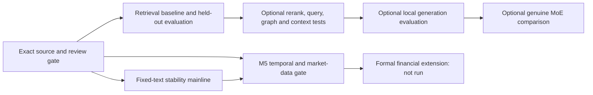

# Proposed technical roadmap (not a frozen protocol)

**Source boundary.** This plan combines the written project request and saved M5–M10 evidence with ten user-supplied route screenshots. The [image source map](ROUTE_IMAGE_SOURCE_MAP.md) records each filename/hash, what is explicitly visible, our project interpretation, and separate new suggestions. The screenshots remain in a private local packet and are not redistributed. Screenshot claims of general superiority are hypotheses, not established results. Every future method here is **PROPOSED** unless marked implemented.

The main scientific recommendation remains **fixed-text representation stability**. The source-bound retrieval assistant is a distinct engineering/evaluation track. Historical return prediction and risk estimation require a separate frozen M5 gate. These workstreams are linked by evidence prerequisites but are not a single mandatory sequence.

| Research question / route source | Prerequisite | Proposed method | Evaluation | Expected artifact | Completion criterion | Unresolved decision |
| --- | --- | --- | --- | --- | --- | --- |
| Which exact 10-Q texts are admissible? (project M8–M9) | Preserve raw, primary, extracted and structured hashes and versioned reviewer decisions | Finish five-company Item 2 review; retain GOOGL sparse header mappings as limitations; record inclusion/exclusion by task | Source-to-extract span/hash checks, table/period review, human decision record | Admissibility register and exclusions | Exact version and review state visible for every admitted document | Who accepts remaining versions; which limited-use derivatives are eligible |
| Which encoder candidates are worth testing? (images 1–2) | Fixed English SEC task/corpus, license/resource limits and human relevance labels | Use [MTEB](https://aclanthology.org/2023.eacl-main.148/) only as broad candidate context; consider domain/language/size/latency, then run matched in-domain comparisons. [C-MTEB](https://arxiv.org/abs/2309.07597) is Chinese-focused and does not rank English SEC suitability by itself | Predeclared retrieval labels, latency/memory, source coverage; STS/classification/clustering only if those tasks are actually defined | Candidate register and fixed-version comparison | Results on held-out, task-matched data with resource and failure reports | Candidate models and task weighting; whether multilingual evaluation matters |
| Can saved disclosure evidence be retrieved reliably? (images 2–3, 7) | Frozen admissible corpus, researcher-checked questions/anchors and nonreused held-out cases | Keep existing M10 BM25, dense and weighted-RRF hybrid as baseline; distinguish directional scores and rank fusion | Predefined [nDCG, Recall@k, MRR or Success@k](https://ir-measur.es/en/latest/measures.html) only when relevance judgments support them; source-span coverage and evidence integrity separately | Frozen retrieval set, runs and error taxonomy | Held-out results and failures reproducible from exact source/index versions | Target uses, labels, metrics, thresholds and split policy |
| Do optional retrieval changes help this task? (images 3–4, 10) | Baseline and frozen relevance set; generated-query provenance and compute budget if needed | Controlled arms for cross-encoder reranking, multi-query/subqueries, [HyDE](https://aclanthology.org/2023.acl-long.99/), parent-context expansion, graph indexing or iterative retrieval; change one factor at a time. Current M10 has **no** reranker, query rewriting, graph or iteration | Matched retrieval quality, failure cases, latency and budget, with no parameter search on held-out set | Separate method receipts and qualified comparisons | Predeclared comparisons on same source/query versions | Which arms merit implementation; acceptable compute and generated-query risks |
| How sensitive are fixed-text company vectors? (project M2–M7; image 4 chunk idea) | Versioned same-section text; pinned tokenizer/encoder and processing | Compare chunk sizes/boundaries, equal vs token weights, lexical length controls and structured serialization, then expand texts/models. Do not count algebraically equivalent tail rules or deterministic repeats as independent runs | Matched-document similarity/rank changes and uncertainty at document/company level; coverage and missingness | Run matrix, mapping/vector hashes, descriptive report | Each contrast changes a declared factor and reports exact scope | Formal corpus, revisions, perturbation grid and independent analysis unit |
| Does long-context position affect grounded answers? (images 5–6) | Real pinned generator, fixed evidence set and evaluated answer task | Test context count/order/position under a predeclared design; [Lost in the Middle](https://aclanthology.org/2024.tacl-1.9/) motivates a test but does not establish a defect or a fix in this project | Position-stratified human-checked evidence use, grounding and token/latency costs | Context-position diagnostic | Real inference and controlled result; no conclusion from prompt advice alone | Generator, context budget, whether fine-tuning is in scope |
| Are generated answers supported? (images 7–8) | Retrieval gate, local generator license/runtime/weights and human rubric | Keep retrieval evaluation separate; assess support, relevance and factual correctness. [RAGAS](https://aclanthology.org/2024.eacl-demo.16/), [ARES](https://aclanthology.org/2024.naacl-long.20/) and [TruLens](https://www.trulens.org/getting_started/core_concepts/rag_triad/) are candidate instruments, not validated labels here | Human-graded groundedness, correctness, unsupported-question behavior; compare automatic judgments to human labels if used | Separate generation output, rubric and error ledger | Real answer inference and reviewed evidence, including failures | Model, evaluator, human sample, acceptable error and cost |
| Does a graph add value for defined relational questions? (images 4, 8–10) | Auditable entity/relation extraction and multi-hop question set | Optional KG plus text retrieval arm; retain source edges, provenance and graph errors | Exact relation/path support, retrieval/answer quality and false edges on a matched set | Versioned graph and source-linked paths | Evidence-backed improvement under predeclared questions, or a clear null/failure report | Whether graph questions are material and extraction is reliable |
| Is genuine MoE worth a separate comparison? (project M10) | Verified sparse-expert weights, local runtime, license, fixed contexts/budget | Only after real routed inference, compare with a fair dense baseline; [Self-RAG](https://arxiv.org/abs/2310.11511) and [Corrective RAG](https://arxiv.org/abs/2401.15884) are different method families, not a synonym for MoE or the current tool router | Grounding and resource measures under controlled model/data/context/hardware | Pinned receipts, execution logs and qualified comparison | Actual inference plus interpretable controls | Resource budget, model and comparator design |
| Does text add financial value beyond prices? (project M5 extension) | **Researcher-frozen M5 protocol**, point-in-time text/revision evidence and permitted adjusted price data | Set decision time, chronology, past-only vocabulary/IDF/scaling/PCA, price/lexical controls, missing/delisted handling, dividend-aware return definition and costs | Predeclared out-of-sample prediction/risk metrics and uncertainty at the correct independent unit | Formal experiment and leakage ledger | Complete temporal audit and approved out-of-sample evaluation | Main task, sample, availability lag, returns, horizons, split, controls, metrics and inference plan |

The saved M10 development check is five source-linked questions with four unique anchors and a custom full-span top-five hit, **not** Recall@5, nDCG, answer accuracy or general retrieval superiority. It has no generator; suggestions about long-context prompts, reranking, fine-tuning or KG are not executed improvements. Fixed-weight repeat inference is not a training-seed study. A future paper should bind every number to a result field, run configuration, source version and code revision.
