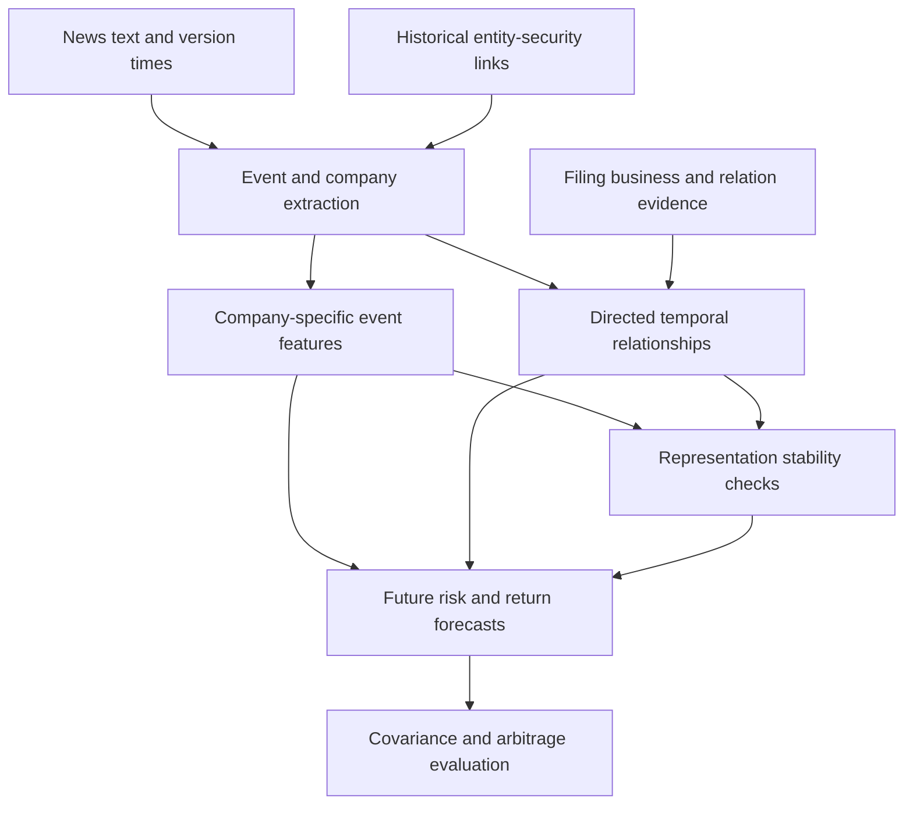

# Technical roadmap: company-specific news, risk spillovers and representation stability

[中文全文](roadmap.zh.md) · [Project entry point](README.md) · [Source access](source_access.md)

Updated: 2026-11-14, Asia/Shanghai. Version: 1.6. Research status: **PROPOSED**. The bounded original-author sample and pinned Qwen 3B snapshot remain fixed. The [v3 development retest](../../reports/2026-11-14_news_schema_repair.en.md) stopped after three attempts with two schema-valid but mechanically invalid responses. [Read-only old-quote diagnosis](../../results/news_grounding_runtime_20261114/old_failure_diagnosis.json) found two unique exact texts, one repeated text and no missing text across three quotes; old model-supplied offsets matched none. The separate [v4 bounded development run](../../reports/2026-11-14_news_grounding_runtime.en.md) attempted all ten fixed articles and saved nine responses, with one externally interrupted call. Its [independent audit](../../results/news_grounding_runtime_20261114/inference_aggregate.json) passed: 8/9 JSON-valid, 1/8 wire-valid, 7/8 quotes uniquely exact and 0/1 wire-valid response canonically constructible. Host-computed offsets and attached binding are not model accuracy metrics. Human adjudication, extraction accuracy, financial evaluation and backtesting remain **NOT_RUN**.

## 1. Research position

Extend the existing financial-text embedding stability project into news research. SEC Item 1 represents a company's slower-moving business and peer relationships; news supplies short-lived events; market data supplies subsequent outcomes. Reuse provenance, identity and timing contracts. Text extraction need not wait for every old CCM issue to be resolved. Rows without supported historical security links may inform extraction-quality studies, but may not enter formal financial evaluation.

The proposed main question is whether company-specific event direction, intensity, uncertainty and novelty improve forecasts of future risk. Then test whether news from related companies adds information, and whether the incremental result survives changes in representation.

LLM outputs measure the meaning of events expressed in text. They do not directly observe investors' psychological states, nor establish that an event caused a price change. Claims about investor sentiment require separate proxies and validity checks.

## 2. How to use the supervisor's resources

### 2.1 financial-news-kg

The inspected main branch pointed to `cc19a5214ef74ae6056434459bb1681a244313c6`. README, schema.py, graph_builder.py and entity_resolver.py were read. This was static inspection, not an execution validation.

Reusable ideas include source adapters, structured relation extraction, evidence citations, sparse graphs and a SQLite edge/evidence store. Prebuilt graphs are not automatically point-in-time historical ground truth.

Required adaptations:

1. The schema retains direction, but graph_builder canonicalizes unordered company pairs; dense adjacency is symmetrized and COO entries also represent undirected pairs. Preserve source company, target company and relation type for spillover analysis.
2. Relationship has one sentiment value. Add a separate event-by-affected-company record to represent different impacts on different companies.
3. entity_resolver matches tickers, names and fuzzy aliases against the configured universe without an effective-date security-selection interface. Use it for candidate generation; formal market admission needs dated mappings.
4. Rolling windows traverse loaded news dates, which are not a complete trading calendar. Use an explicit calendar and available_at cutoff.
5. The repository's descriptions of corpora, model configuration and prebuilt data do not establish that this project holds the same inputs or usage rights.

### 2.2 Avellaneda–Lee

SSRN 1153505 identifies Avellaneda and Lee's *Statistical Arbitrage in the U.S. Equities Market*. The author-hosted draft describes PCA/sector-ETF risk factors, return residuals and mean-reversion strategies. Replacing those factors with LLM news factors is a proposed extension, not an experiment already performed in that paper.

## 3. Data architecture and table contracts

Start with Python and Parquet/DuckDB for analysis, SQLite for provenance indexes and human decisions, and sparse matrices for graphs. Neo4j, GNNs and complex services are not prerequisites. GitHub holds code, contracts, documentation and shareable results; permitted data storage holds actual datasets. GitHub is not the online query engine.

| Table | Unit | Essential fields and constraints |
| --- | --- | --- |
| news_raw | Original article version | source, article_id, revision_id, published_at, vendor_received_at, fetched_at, timezone, timestamp_precision, body_hash, original_text_ref |
| news_events | Event/update | event_id, article_version_ids, dedup_cluster_id, event_type, first_available_at, update_type, evidence_spans |
| entities_and_security_links | Entity and historical security link | entity_id, security_id, valid_from/to, known_from/to, relation_source, source_version, mapping_status; distinguish effective time from knowledge time |
| company_event_impacts | Event × affected company | direct/indirect, subject/target role, polarity, magnitude, uncertainty, relevance, explicit/hypothesis, evidence, raw_model_confidence, missing_reason |
| relation_edges | Typed company relationship | source_entity, target_entity, relation_type, valid interval, known_at, expires_at, evidence, confidence_kind |
| features_asof | Company × decision time × configuration | feature_vector, graph_snapshot_id, max_input_available_at, model/prompt/schema/revision/quantization IDs |
| market_labels | Security × outcome window | label_start/end, session_calendar, target_definition, price/return versions, missing/exit flags |
| experiment_runs | Run | input hashes, split, train_label_end, code commit, model artifacts, device/dtype/seed, configuration, outputs |

WRDS is a platform. The exact news product, text/headline fields, version and account entitlements remain unconfirmed. RavenPack is one officially listed news-analytics supplier; that listing does not establish access to article bodies. Precomputed sentiment without text is not an LLM-readable news corpus.

Inspect a small sample and its access conditions first. Then freeze the query and use resumable partitions supported by the provider. Do not assume a universal requirement to download all history in one query. Preserve contemporary article versions when resolving revisions and syndication; never backfill later text into an earlier forecast.

Hugging Face and Jin10 are candidate sources; see Section 12 and the source-access register. A bounded original-author FNSPID sample has since been saved for text engineering, without formal financial admission.

## 4. Company-specific event measurement

Use evidence-constrained structured extraction. Keep event category, entities, affected companies, direction, magnitude, uncertainty, relevance, novelty, expected duration, direct/indirect impact, quoted evidence and insufficient-information status as separate fields.

The [N1 JSON Schema](company_event_output.schema.json) remains frozen: one article version may have multiple event-by-target-company records or an explicit no-event/no-supported-company disposition. Business impact, already reported market outcome and unobserved future returns are separate. Evidence uses original-body Unicode character offsets checked by the validator. The [original prompt](company_event_prompt.md) produced nine schema-invalid responses in the first development smoke; the [versioned prompt candidate](company_event_prompt_v2.md) places that complete Schema and one invented format example directly in the System message. The two additions form one combined intervention. Mechanical receipts remain separate from extraction accuracy, and human fields remain blank.

One event may create several company records. Judge a product launch's effect on its issuer from the text as well; do not assign a negative effect to every competitor by rule. A point-in-time relationship graph may propose affected companies not explicitly discussed, but the indirect path must have evidence and remain a hypothesis rather than an asserted statement from the article.

For political/regulatory events, measure specific exposures such as jurisdiction, business geography, disclosed contributions or policy dependence, with dates and sources. Do not infer a party affiliation from a company name or equate an individual's politics with company-wide risk.

Raw model confidence is not an empirical probability of correctness. Assess and calibrate it against independent human labels before using it as a weight. No news, no impact, extraction failure and unknown impact are distinct states.

An initial budget of 200 event-company annotations is proposed across event types, positive/negative/mixed/unknown cases, direct/indirect effects and periods. This is a workload budget, not a power guarantee. Annotators should see only the contemporary text, not future returns; preserve independent labels and disagreements. Separate training, calibration and testing by event clusters so syndicated articles do not cross sets.

## 5. Model strategy and look-ahead

Use `Qwen/Qwen2.5-7B-Instruct` as a proposed structured-extraction engineering baseline, compared with `deepseek-ai/DeepSeek-R1-Distill-Qwen-7B`. This choice reflects identifiable, manageable candidates, not demonstrated financial superiority. The latter is based on Qwen2.5-Math-7B and distilled using DeepSeek-R1 samples; the pair is not a comparison of fully independent pretraining families.

The original [v1 smoke configuration](../../configs/news_n1_smoke_v1.json) documented a no-model gate. The [v2 first-run configuration](../../configs/news_n1_smoke_v2.json) binds the official `Qwen/Qwen2.5-3B-Instruct` revision `aa8e72537993ba99e69dfaafa59ed015b17504d1`; the [v3 prompt-retake configuration](../../configs/news_n1_smoke_v3_prompt_complete.json) keeps that model, first-ten input, Schema and all generation budgets while changing only the prompt and experiment metadata. The [model integrity](../../results/news_first_inference_20261114/model_integrity_receipt.json), [first-run receipt](../../results/news_first_inference_20261114/smoke_receipt.json), [candidate replay](../../results/news_schema_repair_20261114/candidate_validation_replay.json) and [audited v3 aggregate](../../results/news_schema_repair_20261114/new_inference_aggregate.json) record separate evidence gates. The v3 run ended at OOM after three attempts, so its two format-compliant but mechanically invalid responses cannot support a full ten-article comparison. This smaller development work does not replace the proposed 7B comparison or establish extraction quality.

The Qwen series announcement is dated 2024-09-19. That is a release record, not a comprehensive training-data cutoff. Verify the actual weight revision's publication/freeze history; a name or series release date is insufficient. The inspected model cards do not establish exact temporal bounds for every pretraining, SFT, RL and distillation stage.

Freeze checkpoint, tokenizer, chat template, prompt and JSON schema before trying fine-tuning. Use LoRA/QLoRA only after error analysis and sufficient labels justify it. Fine-tuning data, teacher-generated labels and retrieval sources are also time-constrained. Training on old news does not erase future knowledge already present in a model. If quantized, record the quantization in the run identity and stability comparison. Measure memory and throughput with short contexts and small batches; parameter count alone does not guarantee a successful deployment.

Two analysis tracks, with a later prospective check:

- **Retrospective:** available history from 2020 onward can support engineering, extraction and association studies. If the model postdates an event, label the result retrospective rather than historically tradable.
- **Temporally valid:** formal evaluation windows must follow the actual model/adapter availability boundary. Prompt choice, feature selection and fitting use training/validation information only. Portions of 2025/2026 are candidates only after checking the exact checkpoint, not automatic whole-year splits.
- **Prospective shadow predictions:** after the study is frozen, save signals before future outcomes arrive. This is a later proposal; this update starts no collection or automation.

Record separately: training cutoff (possibly unknown), weight availability/freeze time, publication/vendor receipt/revision times, mapping knowledge time, edge knowledge time, inference completion, execution time, and label-window endpoints.

Frozen weights receiving only contemporary inputs cannot learn events that first occur after the freeze. This does not remove researcher selection from later prompt, feature or window choices. Report retrospective out-of-sample analysis separately from prospective shadow results.

## 6. Two graph layers and temporal aggregation

Layer one is event → company, preserving company-specific impacts. Layer two is company → company, distinguishing suppliers, customers, competitors, partners and shared risk exposures. Relation direction and economic sign are different fields; a competitor's new product is not necessarily harmful.

Begin with interpretable, evidence-backed typed aggregation rather than a GNN. At cutoff t, summarize X(i,t) as positive intensity, negative intensity, absolute impact, uncertainty, news count, novelty, source disagreement and missingness. Do not average these into a single sentiment number.

Neighbor exposure is G(i,t,r) = Σ_j W(j→i,t-,r) X(j,t), separately for relation type r. The t- graph is known before the current event, separating propagation over existing relationships from relationships first discovered in that event. Same-period new relationships are a separate extension, available only after their first-known time.

Shared events can be counted repeatedly across companies. Retain event_id, deduplicate at the target-company level and compare inclusion/exclusion of shared events. A dated SEC Item 1 similarity graph provides a slow-moving comparator; the news graph supplies faster updates. Filing-derived edges start only when the underlying text becomes available. This preserves the earlier chunking/pooling stability research.

## 7. Financial tasks and executable timing

Choose one primary label, horizon and metric before examining test outcomes. Future volatility is the proposed initial task; returns are secondary rather than competing with covariance and arbitrage for the main result.

With suitable intraday prices, define future-session realized variance as the sum of squared intraday log returns, and volatility as its square root. State whether overnight risk is separate. Use HAR-style daily/weekly/monthly historical-risk components as a baseline, then add own-company news and graph exposures. Use positive parameterization or a log transform with consistent retransformation treatment. Compare variance-scale QLIKE and log-MSE; freeze zero/missing-value rules using training information.

With daily data only, forecast a clearly named multi-day squared-return sum/average as a noisier risk proxy. Do not call it high-frequency realized volatility. Use a baseline appropriate to that target rather than copying an incompatible high-frequency experiment.

Specify news cutoff, price-feature availability, inference delay and executable prices. A possible daily rule freezes information at the close and executes at the next session's open; after-close news enters a later applicable window. Forecast labels and tradable returns may differ, but must be registered separately. Never credit an opening trade with overnight returns earned before that trade.

For returns, reuse the evaluator's event, target and training-cutoff bindings. Compare price history, own-company news and graph exposure on the same rows. Define excess/market-relative returns explicitly, preserve exits and do not select stocks by future survival.

For covariance, first compare shrinkage and traditional factor models. A text-exposure model may use Σhat(t+1|t)=B(t) Ωhat(t+1|t) B(t)' + Dhat(t+1|t), with positive-semidefinite Ω and nonnegative diagonal D; ensure positive definiteness/regularization when inversion is needed. A directed or signed news adjacency matrix is not a covariance matrix.

## 8. What replacing PCA factors means

Distinguish company news features X(i,t), common news states Z(k,t), and tradable factor returns F(k,t). Sentiment scores are not automatically factor returns.

First add X and G as predictors. Next construct common states from training-defined event types or text exposures and test future common-risk information. Only then form portfolios whose weights w(k,t) are chosen at time t, with returns F(k,t+1)=w(k,t)'r(t+1) over the next executable interval.

Risk decomposition, weights, text dimension reduction and scaling use only information available at their cutoff. A period's factor return and residual are known only after that period finishes and can support only later executable trades. Replacing or augmenting PCA still requires testing whether residuals support mean reversion; not every residual is an arbitrage opportunity.

Compare PCA-only, news-only and PCA+news. Assess net performance, drawdown, turnover, transaction/borrowing costs and capacity sensitivity only at the final trading stage. Do not treat a historical paper's Sharpe ratio as this project's target or result.

## 9. Minimum interpretable experiment matrix

| Variant | Features | Question |
| --- | --- | --- |
| B0 | Price/history-based risk | No-text baseline |
| B1 | B0 + news count/attention | Is attention alone sufficient? |
| B2 | B1 + dictionary or training-fitted TF-IDF | Does the LLM exceed inexpensive text methods? |
| B3 | B1 + generic article sentiment | Contribution of generic sentiment |
| B4 | B1 + company-specific event measurements | Value of company-specific interpretation |
| B5 | B4 + typed directed graph exposures | Incremental cross-company information |

Use a common valid sample, identical labels and training windows, and report failure coverage. Missingness must not silently change the evaluated population between models. Also report coverage sensitivity and possible selection bias in complete cases.

Use disjoint chronological train/validation/test sets and walk-forward evaluation. Purge or isolate labels spanning boundaries; training label_end cannot exceed the current training cutoff. The final test cannot select models, horizons or event types. Stock errors share market shocks: use date-block resampling that retains cross-sectional structure, with event-cluster handling where needed, rather than treating articles as independent financial samples.

Graph ablations include industry, filing-similarity and news graphs, plus randomized comparators preserving relevant degree/type properties. Time permutations are negative controls, not valid predictive inputs. Extraction evaluation measures entity linking, event type, company impact, evidence support and calibration; financial evaluation measures out-of-sample loss differences and uncertainty. Neither substitutes for the other.

Stability covers model revision, prompt, chunking, aggregation, quantization, graph window and edge threshold. Start with a small grid rather than its full Cartesian product. Compare company features, rankings, neighbors, edge overlap and downstream loss. Report shared model ancestry. Use multiple seeds for stochastic fitting; deterministic frozen inference primarily needs configuration perturbations, not artificial seed counts.

## 10. Milestones and stop conditions

| Stage | Deliverable | Entry condition for the next stage |
| --- | --- | --- |
| N0 Data availability | Actual product, fields, rights, timing and mapping inventory | A source-bound text sample is accessible; otherwise remain at acquisition |
| N1 Extraction prototype | Company-event schema, annotation guide and measured errors | Meets preregistered usability requirements; fix extraction otherwise |
| N2 Own-news risk prediction | B0–B4 comparisons, splits and coverage | Complete data/identity/timing/price contracts and a concrete reviewable protocol |
| N3 Spillovers and stability | B5, graph ablations and configuration sensitivity | Separate graph increments from duplicate shared events |
| N4 Covariance | PSD risk forecasts and portfolio-risk comparisons | Risk and estimation error are evaluable |
| N5 Factors and arbitrage | PCA/news/hybrid executable backtests | Establish residual behavior and cost/exit rules first |

These are dependencies, not completion percentages or a guaranteed weekly schedule. Preserve null increments; do not keep switching objectives until a profitable result appears.

Existing M5 software and identity work are reusable but establish no new news-based financial result. Advance N0/N1 while waiting for the WRDS source response; N2 onward must retain formal admission and protocol decisions.

## 11. References and verification scope

- [DylanSand/financial-news-kg](https://github.com/DylanSand/financial-news-kg), inspected 2026-11-14 at the commit above.
- Avellaneda, M.; Lee, J.-H., [author-hosted draft dated 2009-06-15](https://math.nyu.edu/inmemoriam/avellaneda/AvellanedaLeeStatArb20090616.pdf). User-supplied SSRN ID 1153505; journal entry *Quantitative Finance* 10(7), 761–782 (2010), DOI 10.1080/14697680903124632. Final publisher full text was inaccessible; it was not checked word-for-word against the draft.
- [Qwen release announcement](https://qwenlm.github.io/blog/qwen2.5/) and [official model card](https://huggingface.co/Qwen/Qwen2.5-7B-Instruct): support identity and stated structured-output capability, not financial superiority or an exact comprehensive training cutoff.
- [DeepSeek official model card](https://huggingface.co/deepseek-ai/DeepSeek-R1-Distill-Qwen-7B): supports base-model/distillation ancestry, not financial specialization.
- [WRDS RavenPack product page](https://wrds-www.wharton.upenn.edu/pages/about/data-vendors/ravenpack/): does not establish account access or downloaded contents.
- Corsi, F. (2009), *A Simple Approximate Long-Memory Model of Realized Volatility*, *Journal of Financial Econometrics* 7(2), 174–196, DOI 10.1093/jjfinec/nbp001. [University-hosted paper inspected](https://statmath.wu.ac.at/~hauser/LVs/FinEtricsQF/References/Corsi2009JFinEtrics_LMmodelRealizedVola.pdf); basis for the HAR comparator.
- Ledoit, O.; Wolf, M., *Honey, I shrunk the sample covariance matrix*. [Institutional working-paper abstract inspected](https://econ-papers.upf.edu/en/onepaper.php?id=691); basis for the shrinkage comparator.

The transcript terms Garage, JACC, Identity AI, 910 public datasets and Qwen-27B remain insufficiently identified and are not configuration or citation authorities. Use full model repository IDs and revisions. Proposed budgets, metrics, comparisons and milestones are this project's design suggestions, not verbatim supervisor instructions or executed results.

## 12. Hugging Face and Jin10 source extension

The user has identified Hugging Face and Jin10 as acceptable candidate news platforms. Account possession is not a completed connection or proof of access to each dataset. An original-author FNSPID file was accessed anonymously at a pinned revision for one bounded local text sample; no account authentication, full-corpus download or account change was performed. The sampled file's upstream license statements conflict on commercial use, and article-text redistribution rights remain unverified; see [source_access.md](source_access.md).

Hugging Face can supply bounded historical engineering samples. Register each dataset ID, immutable revision, source subset, time precision and upstream rights. A normalized date/trading anchor is not necessarily the original publication instant. Use Jin10's official access route for news/flash candidates; historical depth and account-specific limits need a real authorized response before claiming 2020–2026 coverage. Keep original language and distinguish translated versions.

See [source_access.md](source_access.md) for inspected candidates, the bounded FNSPID receipt and staged admission, and [sources.json](sources.json) for machine-readable evidence. The [sample profile](../../results/news_n1_20261114/sample_profile.json) describes only the first 100 saved records; it does not establish population coverage, original publication instants or historical securities. Never commit account screenshots, credentials or restricted article text. New source adapters must preserve the same event-company identity, version and availability contracts as WRDS.
