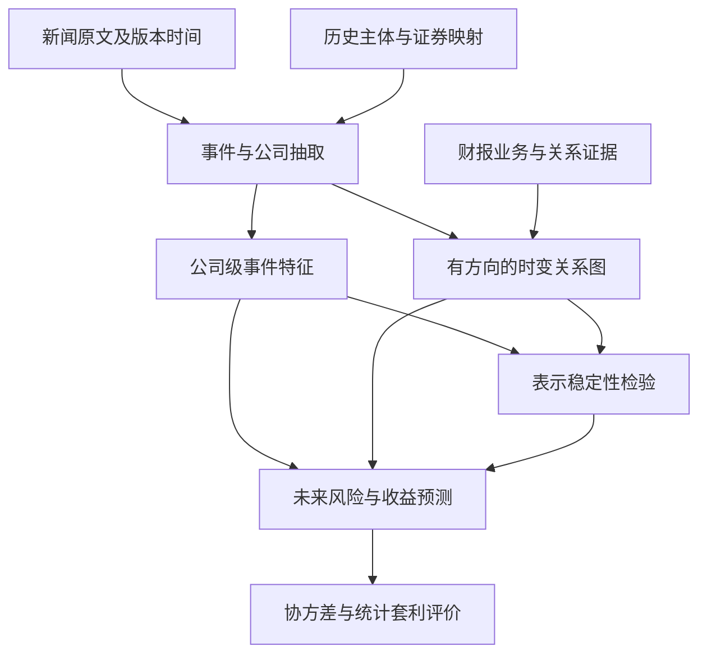

# 整体技术路线：公司级新闻情绪、跨公司风险传播与稳定性

[English full text](roadmap.en.md) · [项目入口](README.md) · [来源接入](source_access.md)

更新：2026-11-14（Asia/Shanghai）。版本：1.5。研究状态 **PROPOSED**；原作者有界样本、N1 输出 Schema 与官方固定 Qwen 3B 快照继续固定。[首次开发冒烟](../../reports/2026-11-14_news_first_inference.zh.md)保存九份响应，均不符合 Schema；[离线归类](../../results/news_schema_repair_20261114/old_error_aggregate.json)已核对具体错误。完整契约提示词复测在第 3 次尝试时因 OOM 停止：两份已保存响应均符合 Schema，但均未通过最终机械检查，其余七篇未尝试。详见[本轮报告](../../reports/2026-11-14_news_schema_repair.zh.md)和[审计比较](../../results/news_schema_repair_20261114/paired_comparison.json)。人工裁定、抽取准确率、金融评估与回测均 **NOT_RUN**。

## 1. 研究定位

把已有财报嵌入稳定性工作接到新闻研究上：SEC Item 1 表征公司长期业务与同行关系；新闻提供短期事件；行情提供事后标签。共享来源、身份和时间契约，但新闻抽取不必等待旧 CCM 问题全部解决。历史证券关系没有证据的行可以用于文本抽取质量评估，不能进入正式金融评价。

第一篇工作的主问题建议定为：公司级事件方向、强度、不确定性和新闻新颖度，能否改善未来风险预测？随后检验历史公司关系引入的邻居新闻是否进一步改善预测，以及这种改善是否经得起表示方式变化。

LLM 输出是对文本中事件含义的测量，不是直接观察到的投资者心理，也不是事件造成股价变化的因果证明。若要使用“投资者情绪”这一表述，需要独立代理变量和效度检验。

## 2. 导师资源如何使用

### 2.1 financial-news-kg

读取时 main 指向 `cc19a5214ef74ae6056434459bb1681a244313c6`。检查了 README、schema.py、graph_builder.py 和 entity_resolver.py；静态检查，不代表执行验证。

可借用：多来源接入、结构化关系抽取、证据引用、稀疏图和 SQLite 边证据存储。不能直接把预建图作为无前视偏差的历史关系真值。

需要改造：
1. schema 虽有 direction，但 graph_builder 将公司对标准化成无序对；dense 邻接矩阵被对称化，COO 也表示无向公司对。正式溢出模块必须保留源公司、目标公司及关系类型。
2. Relationship 只有单个 sentiment；需另外建立 event×affected_company 输出，分别描述不同公司的影响。
3. entity_resolver 按 ticker/名称/模糊匹配关联当前配置的 universe，没有按有效日期进行历史证券选择的接口。保留为候选生成器，金融准入用有日期依据的映射表。
4. rolling windows 遍历已加载的新闻日期，不等于完整交易日日历。新管道用明确的交易日和 available_at 截止。
5. README 的多来源语料、模型配置、预建数据是仓库自身说明，不等于用户拥有相同数据或相同许可证。

### 2.2 Avellaneda–Lee

SSRN 1153505 对应 Avellaneda 和 Lee 的 Statistical Arbitrage in the U.S. Equities Market。作者机构稿说明 PCA 或行业 ETF 风险因素、收益残差及均值回归交易思路。“换成 LLM 新闻因子”是新研究提案，不是该论文已完成的实验。

## 3. 数据架构与表契约

推荐最初用 Python + Parquet/DuckDB 保存分析数据，SQLite 保存来源索引与人工判定；用稀疏矩阵保存图。Neo4j、GNN 和复杂服务化均非首轮必需。GitHub 管理代码、契约、文档和可分享结果，实际数据放在允许的存储中；GitHub 不承担在线数据库查询服务。

| 表 | 单位 | 关键字段与约束 |
| --- | --- | --- |
| news_raw | 原始文章版本 | source, article_id, revision_id, published_at, vendor_received_at, fetched_at, timezone, timestamp_precision, body_hash, original_text_ref |
| news_events | 事件/更新 | event_id, article_version_ids, dedup_cluster_id, event_type, first_available_at, update_type, evidence_spans |
| entities_and_security_links | 主体与历史证券关系 | entity_id, security_id, valid_from/to, known_from/to, relation_source, source_version, mapping_status；分别存有效时间与知晓时间 |
| company_event_impacts | 事件×受影响公司 | direct/indirect, subject/target role, polarity, magnitude, uncertainty, relevance, explicit/hypothesis, evidence, raw_model_confidence, missing_reason |
| relation_edges | 有类型的公司关系 | source_entity, target_entity, relation_type, valid interval, known_at, expires_at, evidence, confidence_kind |
| features_asof | 公司×决策时点×配置 | feature_vector, graph_snapshot_id, max_input_available_at, model/prompt/schema/revision/quantization IDs |
| market_labels | 证券×目标窗口 | label_start/end, session_calendar, target_definition, prices/returns versions, missing/exit flags |
| experiment_runs | 一次运行 | inputs hashes, split, train_label_end, code commit, model artifacts, device/dtype/seed, configuration, outputs |

WRDS 是平台，具体新闻产品、正文/标题字段、版本和账户权限仍待确认。RavenPack 是官方列示的一种新闻分析供应商，不代表用户已有其正文权限。只有预计算情绪分数而无正文时，不能称为已获得可供 LLM 阅读的新闻语料。

Hugging Face 与金十是候选新闻来源，见第 12 节及来源接入登记。现有原作者 FNSPID 有界样本可用于文本工程，但尚未获得正式金融准入。

先做小样本字段与权限检查，再固定查询、按供应商支持的大小进行可恢复分区导出；不把“必须单次下载全部”当作通用规则。合并新闻、修订和转载时保持当时版本，不将后续补充内容回填给早期预测。

## 4. 公司特定事件测量

用证据约束的结构化抽取，输出以下并列维度：事件类别、涉及主体、受影响公司、影响方向、影响强度、不确定性、公司相关性、事件新颖度、预期持续区间、直接/间接影响、引用文本和信息不足状态。

当前 [N1 JSON Schema](company_event_output.schema.json)继续冻结：一篇文章版本可有多个事件×目标公司条目，也可明确记录无事件或无支持公司的状态。业务影响、文章已报道的市场结果和未观测未来收益分别表示；证据使用原始正文 Unicode 字符索引并由校验器检查。[原提示词](company_event_prompt.md)在首次开发冒烟产生九份不符合 Schema 的响应；[版本化候选提示词](company_event_prompt_v2.md)把完整 Schema 和一个虚构格式示例直接放入 System 消息。两项添加属于同一个候选变化，不能拆开归因。机械回执与抽取准确率分开，人工栏仍为空。

同一事件可产生多个公司条目。新品对发布方的影响也应按文本判断；不能把所有竞争关系机械设成负面。没有被新闻直接讨论的公司，可以由当时可用关系图产生候选受影响对象，但间接路径必须有出处，并标成推断假设，不伪装为原文事实。

政治/监管事件先测量具体暴露（监管权限、业务地区、已披露捐赠或政策依赖），绑定日期和来源；不让模型凭公司名猜党派，更不能将个人政治倾向直接等同公司整体风险。

置信度只是一项原始模型输出，不是真实正确率。通过独立人工集评估并校准后才能据此赋权。没有新闻、没有影响、抽取失败和无法判断必须分开编码。

建议首轮人工检查 200 个事件—公司条目，覆盖不同事件、正负/混合/未知、直接/间接及时间段；这是工作量预算，不是统计充分性保证。由标注者只看当时文本，不看未来收益，独立标注并记录分歧。训练/校准/测试按事件簇隔离，不能让同一新闻的转载跨集合。

## 5. 模型策略与前视偏差

建议先以 `Qwen/Qwen2.5-7B-Instruct` 为结构化抽取工程基线，对照 `deepseek-ai/DeepSeek-R1-Distill-Qwen-7B`。选择理由是规模可控且身份明确，不是已证明前者更擅长金融预测。后者基于 Qwen2.5-Math-7B，经 DeepSeek-R1 数据蒸馏，因此二者不是完全独立的预训练家族。

原 [v1 冒烟配置](../../configs/news_n1_smoke_v1.json)记录缺模型门槛。[首次运行 v2 配置](../../configs/news_n1_smoke_v2.json)绑定官方 `Qwen/Qwen2.5-3B-Instruct` revision `aa8e72537993ba99e69dfaafa59ed015b17504d1`；[提示词复测 v3 配置](../../configs/news_n1_smoke_v3_prompt_complete.json)保持模型、前十篇输入、Schema 和全部生成预算，变化仅为提示词及实验标记。[模型完整性](../../results/news_first_inference_20261114/model_integrity_receipt.json)、[首次运行回执](../../results/news_first_inference_20261114/smoke_receipt.json)、[候选离线回读](../../results/news_schema_repair_20261114/candidate_validation_replay.json)和 [v3 审计聚合回执](../../results/news_schema_repair_20261114/new_inference_aggregate.json)分别记录不同证据门槛。v3 在三次尝试后因 OOM 终止；两份格式合规但最终机械检查失败的响应不能支持十篇完整比较。这项较小的开发工作不替代拟议的 7B 模型对照，也不构成抽取质量结论。

Qwen 官方发布文章日期为 2024-09-19；这是系列发布记录，不是全部训练材料的截止日期。最终必须核对确切权重 revision 的公开/冻结记录，不能仅凭模型名称或系列发布日期判定时间有效性。当前已读模型卡不足以证明所有预训练、SFT、RL 和蒸馏数据的精确时间上限。

先固定 checkpoint、tokenizer、chat template、提示词和 JSON schema 做无微调试验；只有标注误差模式明确且数据足够时才做 LoRA/QLoRA。微调数据、教师生成标注和检索库也受截止日期约束。旧新闻微调不会擦除模型已有未来知识。若使用量化，量化配置本身进入实验身份与稳定性比较；显存/吞吐以实际短上下文、小 batch 测量决定，不能仅按参数量保证可运行。

双轨实验：
- 历史回顾轨：2020 年起的可用历史数据用于工程、抽取与关联研究；若模型晚于这些事件，明确标为 retrospective，不能声称当年可交易。
- 时间有效轨：正式评价窗口须晚于确切模型/适配器权重可获得时点；提示词、特征选择和所有拟合步骤只使用训练/验证信息。2025/2026 只能在满足具体 checkpoint 时间边界后作为候选窗口，不能直接按整年划分。
- 从当前方案冻结后开始另存 shadow prediction：未来数据到来前保存信号，作为更强的前瞻证据。属于后续提案，本包没有创建定时任务或开始收集。

时间轴分开记录：训练材料截止时间（可未知）、权重公开/冻结时间、新闻首次发布/供应商接收/修订时间、历史主体映射知晓时间、图边首次知晓时间、可推断完成时间、下单时间、标签窗口起止。

冻结权重后只用当时输入，可避免其学习冻结后才发生的事件；但仍不能排除研究者在选提示词、特征和回测窗口时看到测试结果。因此历史外样本与前瞻 shadow 要分开报告。

## 6. 两层图与时间聚合

第一层：事件 → 公司。保存一个事件对不同公司的独立影响。
第二层：公司 → 公司。区分供应、客户、竞争、合作、共同风险暴露等关系。关系方向与经济影响正负是不同字段。竞争者新品不必对另一方必然负面。

先用证据支持的类型图做可解释加权，不先上 GNN。对公司 i，在截止 t 的事件窗口内聚合成 X(i,t)：正面强度、负面强度、绝对冲击、不确定性、新闻数量、新颖度、跨来源分歧和缺失标记。保持各维度，不只平均成单个情绪分数。

邻居暴露：G(i,t,r) = Σ_j W(j→i,t-,r) X(j,t)。每种关系 r 分别计算；t- 表示当前事件前已知的结构图，以区分旧关系传播和当前新闻中新发现的关系。同期新关系可做单独扩展，只能从首次可用时点起使用。

同一事件涉及多家公司时传播会重复计数；保留 event_id，在按目标公司聚合时去重，并分别做“含共享事件”和“去共享事件”敏感性分析。

SEC Item 1 邻居图可作为慢变量基线，新闻图作为快变量；所有财报边从文本真正可用时间起生效。这里继承已有切块/聚合稳定性研究。

## 7. 金融任务与可交易定义

先选择唯一的主标签、主预测期限与主指标，并在看测试结果前冻结。第一阶段建议未来波动率；收益预测为次级，不与协方差/套利同时争夺主结果。

若有合适日内价格，定义未来交易时段 realized variance 为日内对数收益平方和，波动率为其平方根。明确 overnight 是否另列。以 HAR 的日/周/月历史风险分量为基线，再加公司新闻和图传播特征；使用正值参数化或 log 变换，并对转换偏差作一致处理。比较 QLIKE（方差口径）与 log-MSE；零值/缺失处理阈值只由训练协议确定。

若只有日线，先预测未来多日平方收益和/平均值这一噪声较大的风险代理量，明确名称；不把它包装成高频 realized volatility。基线使用匹配标签的历史风险模型；不能直接复制不适用的高频实验名称。

新闻 cutoff、价格特征可用时点、推断延迟和可执行交易价格都必须写清。日线方案可采用“收盘信息冻结、下一交易时段开盘交易”的候选规则；盘后新闻进入后续可用窗口。预测标签与可交易收益可以不同，但分别登记，禁止用开盘下单后无法赚取的隔夜收益当策略利润。

收益分支：用已有 evaluator 的同事件、同目标、同训练截止绑定，比较历史价格基线 + 自身新闻 + 图传播。按规则计算超额/市场相对收益，并保留退出事件，不用未来存在性挑股票。

协方差分支：先比较收缩协方差和传统因子模型，再使用文本暴露 B(t) 构造 Σhat(t+1|t)=B(t) Ωhat(t+1|t) B(t)' + Dhat(t+1|t)。Ω 必须半正定，D 对角非负；实际求逆时确保正定/正则化。文本图本身不是协方差矩阵，不能直接拿有向/有符号邻接矩阵当风险矩阵。

## 8. 如何真正检验“替代 PCA 因子”

区分三个对象：公司新闻特征 X(i,t)；共同新闻状态 Z(k,t)；可交易因子收益 F(k,t)。情绪分数并不天然等于风险因子收益。

第一步先把 X、G 作为额外预测变量。第二步按训练期确定的事件类别或文本暴露构造共同状态，评价是否解释未来共同风险。第三步才构造在 t 时决定持仓权重 w(k,t)、在下一可交易区间实现收益 F(k,t+1)=w(k,t)'r(t+1) 的因子组合。

用于风险分解的估计、组合权重、文本降维和标准化只能使用截止当时的信息。某期因子收益与残差要到该期结束后才知道，只能产生更晚可执行的交易。用这些因子替代/增补 PCA 后，还必须检验残差是否适合均值回归，不能假定任何残差都可套利。

建议比较 PCA-only、news-only、PCA+news。统计套利最后评估净收益、回撤、换手、成本/借券及容量敏感性，不复制旧论文的历史 Sharpe 当本项目收益目标。

## 9. 最小可解释实验矩阵

| 方案 | 特征 | 想检验的问题 |
| --- | --- | --- |
| B0 | 价格/历史风险 | 无文本基线 |
| B1 | B0 + 新闻数量/关注度 | 是否只是报道变多 |
| B2 | B1 + 简单词典或训练期拟合的 TF-IDF | LLM 是否超出廉价文本方法 |
| B3 | B1 + 普通文章情绪 | 普通情绪的贡献 |
| B4 | B1 + 公司级事件测量 | 针对公司的测量是否改善 |
| B5 | B4 + 类型/有方向图传播 | 跨公司信息是否有增量 |

所有方案使用共同有效样本、同一价格标签与训练窗口，记录失败覆盖率。排除缺失不能随模型变化而偷偷改变样本。另做全覆盖敏感性，解释完整案例样本可能存在选择偏差。

时间切分使用不重叠的 train/validation/test 与 walk-forward；跨边界的标签窗口要剔除或隔离，训练 label_end 不能越过当期训练截止。最终测试不参与模型/窗口/事件类型选择。同期股票共享市场冲击，误差不独立；置信区间按日期块重采样、保留横截面结构，必要时对事件簇再处理，不能将每条新闻当独立样本。

关系图消融包含行业图、财报相似图、新闻图，以及保持度数/类型等特性的随机图。时间置换仅作负对照，不是合法预测特征。抽取评估看主体链接、事件类型、公司影响、证据支持与校准；金融评估看外样本损失差异及不确定区间，二者不可互相替代。

稳定性覆盖模型 revision、prompt、chunk、聚合、量化、图窗口、边阈值；只先筛小网格，避免全笛卡尔积。比较公司特征/排序/邻居、图边重合和下游损失变化。若模型共享底座，报告依赖关系。随机训练时多 seed；确定性冻结推理则重点检验配置扰动，不制造无意义 seed 次数。

## 10. 阶段交付与停止条件

| 阶段 | 交付 | 进入下一阶段的条件 |
| --- | --- | --- |
| N0 数据可用性 | 具体新闻产品、字段、授权边界、可用时间和实体映射清单 | 至少能取得有来源绑定的文本小样本；否则停留数据获取 |
| N1 抽取原型 | 公司级事件 schema、标注指南、实际抽取误差报告 | 达到预先登记的可用性标准；不合格先修抽取 |
| N2 自身新闻风险预测 | B0–B4 公平比较、时间切分和覆盖报告 | 数据/身份/时间/价格契约完整，主协议具体可审阅 |
| N3 关系传播与稳定性 | B5、图消融、配置敏感性 | 分清图带来的增量和共享事件重复计数 |
| N4 协方差 | 半正定风险预测及组合风险比较 | 风险与估计误差可评价 |
| N5 因子与统计套利 | PCA/news/hybrid、可交易回测 | 先证实残差行为、落实成本和退出规则 |

阶段是依赖顺序，不是工作量百分比或保证成功的周计划。预测增量为零也应保留并报告；不因结果不理想就不断换目标直到盈利。

当前既有 M5 软件与身份工作可以复用，但尚未证实新新闻研究的金融效果。建议立即推进 N0/N1，同时等待 WRDS 来源回复；N2 以后不跳过正式准入和协议决定。

## 11. 引用与核验范围

- GitHub：DylanSand/financial-news-kg，检查日期 2026-11-14，commit 见上。https://github.com/DylanSand/financial-news-kg
- Avellaneda, M.; Lee, J.-H. 作者机构稿，2009-06-15： https://math.nyu.edu/inmemoriam/avellaneda/AvellanedaLeeStatArb20090616.pdf 。用户给出的 SSRN ID 1153505；期刊条目 Quantitative Finance 10(7), 761–782 (2010), DOI 10.1080/14697680903124632；最终版全文访问受阻。
- Qwen 官方发布记录：https://qwenlm.github.io/blog/qwen2.5/ 。模型卡：https://huggingface.co/Qwen/Qwen2.5-7B-Instruct 。支持模型身份与结构化输出能力声明，不证明金融优势或精确训练截止。
- DeepSeek 官方模型卡：https://huggingface.co/deepseek-ai/DeepSeek-R1-Distill-Qwen-7B 。支持蒸馏/底座关系，不证明它是金融专用模型。
- WRDS RavenPack 产品介绍：https://wrds-www.wharton.upenn.edu/pages/about/data-vendors/ravenpack/ 。不证明用户账户的权限或已下载内容。
- Corsi, F. (2009), A Simple Approximate Long-Memory Model of Realized Volatility, Journal of Financial Econometrics 7(2), 174–196, DOI 10.1093/jjfinec/nbp001。已读大学托管论文： https://statmath.wu.ac.at/~hauser/LVs/FinEtricsQF/References/Corsi2009JFinEtrics_LMmodelRealizedVola.pdf 。支持 HAR 风险基线的出处。
- Ledoit, O.; Wolf, M., Honey, I shrunk the sample covariance matrix。已读作者机构工作论文页： https://econ-papers.upf.edu/en/onepaper.php?id=691 。支持收缩协方差基线的选择。

转写中的 Garage、JACC、Identity AI、910 个数据集和 Qwen-27B 未获得足够身份确认，不据此建立引用或配置。具体模型用完整 repo ID 与 revision。以上建议的规模、指标、模型对照与阶段安排是本项目设计，不是导师原话或已运行结果。

## 12. Hugging Face 与金十来源扩展

用户已将 Hugging Face 与金十指定为可考虑的新闻平台。拥有账号不等于已经连接，也不证明每个数据集的访问权限。本轮从原作者 FNSPID 的固定版本匿名读取一份本机有界文本样本；没有进行账户认证、全库下载或账户变更。该来源对商业使用的文字互相冲突，新闻正文再分发权未核实；见 [source_access.md](source_access.md)。

Hugging Face 可提供有限历史工程样本；逐项登记 dataset ID、不可变 revision、来源子集、时间精度和上游权限。归一化日期或交易日锚点不必然等于原文发布时间。金十采用官方接入方式作为快讯/资讯候选；2020—2026 历史覆盖及账号限额须根据真实授权响应确认。保留原语言，并区分翻译版本。

见 [source_access.md](source_access.md) 的候选核验、FNSPID 有界读取回执与分阶段准入，以及 [sources.json](sources.json) 的机器可读依据。[样本概况](../../results/news_n1_20261114/sample_profile.json)只描述开头保存的 100 条记录，不证明总体覆盖、原始发布时间或历史证券身份。账户截图、凭据和受限新闻正文不提交 GitHub。新增适配器沿用与 WRDS 相同的事件—公司身份、版本和可用时间契约。
