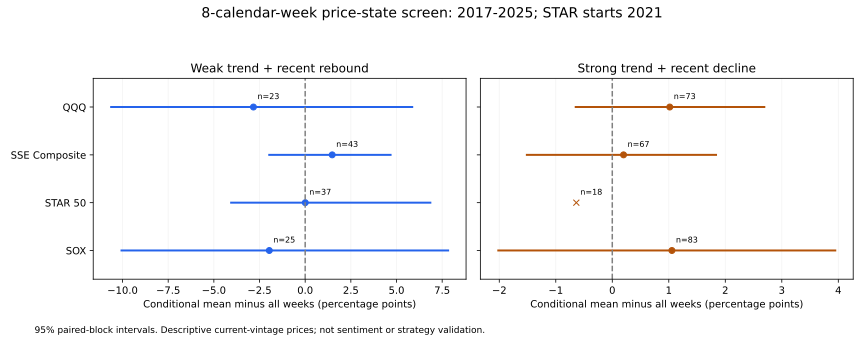
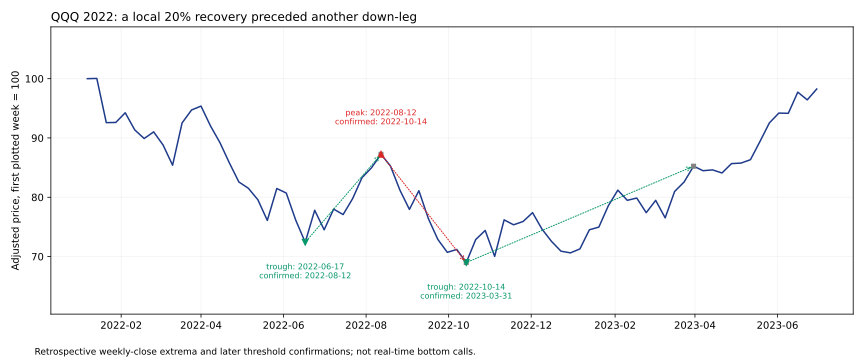

# 中期市场情绪拐点研究：第一阶段结果

日期：2026-11-19（北京时间）。输入：moomoo 研究价格数据集 v0.1；日线截止 2026-11-17，本轮完整周截至 2026-11-13。

**本轮已固定研究规则，执行价格基线和全部阈值拐点扫描，完成历史案例与原始文献对照。结果尚不足以支持统一的价格反转规则；新闻情绪因子仍待计算与验证。**

## 1. 实际完成了什么

| 计划 | 实际产物 | 状态 |
|---|---|---|
| 先固定拐点、窗口和分段规则 | PROTOCOL_zh.md、config.json、freeze_receipt.json，在结果计算前保存 | 完成；研究者制定，不是公开注册或盲测 |
| 四条代理分别计算价格状态及4/8/12自然周结果 | results/weekly_panel.csv、baseline_summary.csv、state_contrasts.csv | 完成，保留所有状态、分段和窗口 |
| 扫描事后极值及确认时间 | results/cycles_all_thresholds.csv，20%主版本、10%敏感性 | 完成，包含反向拐点，末端未确认区间不当已知拐点 |
| 核对历史背景和热门因子 | citation_audit.json、case_registry.json | 首轮完成：16份直接查阅资料；案例用于解释机制 |
| 原始输入重算与无前视检查 | results/self_check.json | 同一执行方自检通过，不是外部独立审计 |
| 追加检查情绪原始数据入口 | external_input_probe/ | BW工作簿已下载并审计；AAII下载403，未取得历史文件 |

运行生成 270 行状态统计、108 行状态差比较、401 条两种阈值合计的已确认极值。它们共享日期、标的和未来窗口，不能当作独立实验或独立危机的数量。旧的 OECD/FRED 月度初筛使用不同输入和定义，本轮未合并，也未把旧结果称为新复现。

## 2. 我们如何定义拐点

**事后标签**采用方向变化扫描：从局部低位上涨20%后，才确认先前的低位；从局部高位回落20%后，才确认先前高位。极值日和确认日分列。这是本轮案例整理的操作定义，阈值会使低波动指数的确认很慢，不能称为统一的情绪反转标准。10%版本完整保留，未按哪个版本更好看选择结论。

**当时可计算的状态**由26个有报价周的均价及4个有报价周的价格变化划分：

| 状态 | 当周能看到的条件 |
|---|---|
| 弱势续跌 | 收盘低于26周均价，最近4个观察周变化≤0 |
| 弱势反弹 | 收盘低于26周均价，最近4个观察周变化>0 |
| 强势续涨 | 收盘不低于26周均价，最近4个观察周变化≥0 |
| 强势转弱 | 收盘不低于26周均价，最近4个观察周变化<0 |

另保存13周动量、52周回撤和13周实现波动率，作为后续控制变量。本阶段未拟合或比较预测模型，也未单独估计这些控制的增量贡献。实现波动率按观察周收益计算并作名义年化；它不等于期权隐含的VIX。[M02]

观察周特征窗口会因整周休市跨越更多自然日，起始日期逐行保存；未来评价严格按4/8/12个自然周定位。信号后下一个观察周的收盘起算，目标日之前最近的观察周收盘作为终点，记录实际起止日期、最多14天端点滞后；未成熟窗口不计算。它是延后观察的价格变化，不是可成交收益、持仓策略或总回报。

## 3. 首轮价格基线：反弹还不足以确认中期改善

以下为协议指定的主展示：2017—2025时间检查段、8自然周窗口。QQQ、上证和SOX合格信号日期为2017-01-06至2025-10-24；科创50为2021-07-23至2025-10-24。均在各自区间内剔除跨界及未成熟标签。这里不是从未见过历史的独立样本外测试。

弱势反弹相对同标的同段全部合格周：

| 标的 | 信号周数 / 连续段数 | 后续均值 | 全部周均值 | 均值差（百分点） | 均值差95%区间（百分点） |
|---|---:|---:|---:|---:|---|
| QQQ | 23 / 8 | 0.34% | 3.18% | -2.833 | [-10.68, +5.91] |
| 上证综指 | 43 / 18 | 2.00% | 0.52% | +1.479 | [-2.02, +4.73] |
| 科创50 | 37 / 14 | 0.42% | 0.42% | +0.005 | [-4.11, +6.91] |
| SOX | 25 / 13 | 2.12% | 4.08% | -1.965 | [-10.11, +7.88] |

主区间由26观察周的成对循环区块bootstrap产生，2,000次、种子20261119。完整13/52观察周区块敏感性及4/12自然周结果在CSV，不按结果挑窗口。周数和连续段数不是独立事件样本量。

在这组固定规则下，均值差方向并不一致，四个弱势反弹组的主区间都覆盖零。现阶段不能判断“低于中期均线时出现反弹”稳定改善后续分布，也不能把组间差当作情绪的因果贡献。

强势转弱的同一检查：

| 标的 | 信号周数 | 后续均值 | 相对全部周均值差（百分点） | 均值差95%区间（百分点） |
|---|---:|---:|---:|---|
| QQQ | 73 | 4.20% | +1.017 | [-0.66, +2.71] |
| 上证综指 | 67 | 0.72% | +0.199 | [-1.53, +1.85] |
| 科创50 | 18 | -0.22% | -0.636 | 样本不足，未给区间 |
| SOX | 83 | 5.14% | +1.055 | [-2.03, +3.96] |

强势内短期下跌同样没有在本配置中形成一致的负向后续差。科创50该组样本低于预设20周门槛，不给区间；不能解释为“确认无效”。这些是描述性检查，未作多重比较校正，不使用显著性发现措辞。



## 4. 历史对照：极值、确认与政策不是同一个时间

以下是有历史知识背景的说明性案例，并非随机或穷尽的历史事件样本。表中日期是本轮周收盘规则输出，不是盘中或逐日极值，不替代更广市场的官方低点。所有阈值拐点另附完整CSV，未只保留成功反弹。

| 案例窗口 | 周收盘极值 → 后来的20%规则确认 | 要分开研究的机制 |
|---|---|---|
| C01 SOX 1998—1998 | 高 1998-04-24 → 确认 1998-06-05；低 1998-09-04 → 确认 1998-10-23 | 信用收缩、风险重估与融资修复；QQQ在该段无价格历史 [H01] |
| C02 QQQ 2000—2003 | 高 2000-03-24 → 确认 2000-04-14；低 2000-05-26 → 确认 2000-06-02；高 2000-09-01 → 确认 2000-10-13；低 2001-04-06 → 确认 2001-04-20；高 2001-05-25 → 确认 2001-08-17；低 2001-09-21 → 确认 2001-10-12；高 2001-12-07 → 确认 2002-04-12；低 2002-10-04 → 确认 2002-10-25 | 大幅反弹可能再次下跌；实际财报、事前预期和前瞻指引必须分开 [H02] |
| C03 上证综指 2004—2006 | 高 2004-04-02 → 确认 2004-06-25；低 2005-06-03 → 确认 2006-01-13 | 政策试点宣布、实施和价格转向是不同时间 [H04] |
| C04 QQQ 2007—2009 | 高 2007-11-02 → 确认 2008-02-08；低 2009-03-06 → 确认 2009-04-03 | 金融条件与经济数据的修复不要求同日发生；官方历史回顾不当实时信号 [H03] |
| C05 上证综指 2014—2016 | 高 2015-06-12 → 确认 2015-07-03；低 2016-01-29 → 确认 2017-04-07 | 强平与分级基金约束值得单独度量；本轮投诉资料只支持其存在 [H05] |
| C06 QQQ 2018—2019 | 高 2018-08-31 → 确认 2018-12-21；低 2018-12-21 → 确认 2019-03-15 | 政策耐心表述与价格极值、后续确认的先后关系 [H06] |
| C07 上证综指 2018—2019 | 高 2018-01-26 → 确认 2018-07-06；低 2018-12-28 → 确认 2019-03-01 | 美国政策只作外部背景，不能替代A股本地融资与政策数据 [H06] |
| C08 QQQ 2020—2020 | 高 2020-02-14 → 确认 2020-03-20；低 2020-03-20 → 确认 2020-04-17 | 市场运作和信用传导的政策措施；不等于疫情损害已结束 [H07] |
| C09 QQQ 2022—2023 | 低 2022-06-17 → 确认 2022-08-12；高 2022-08-12 → 确认 2022-10-14；低 2022-10-14 → 确认 2023-03-31 | 反弹失败与后来价格确认；加息速度和终点分开，纪要发布时间不得前移 [H08] |
| C10 上证综指 2024—2024 | 低 2024-09-13 → 确认 2024-09-30 | 政策宣布与更早的周收盘极值分开；不按日期靠近认定因果 [H09] |

**值得重点追查的两个反例：**

- 美联储2003年报告回顾2002年时，记载部分实际盈利匹配或超过预期，前瞻销售与利润仍不乐观，市场反弹也曾失败。[H02] 因此后续新闻结构化必须把实际财报、公告前预期和指引分开。
- 本轮QQQ20%规则先把2022-06-17的周收盘低位确认于2022-08-12，随后2022-08-12又成为局部高位，于2022-10-14确认下转。20%的局部回升仍可能接着再次下跌；不能把“达到涨幅阈值”直接当作熊市结束。此结论仅指该操作规则下的这条价格序列。



历史资料支持把信用约束、盈利预期和政策表述单独记录；尚未提供“情绪差到某个程度后固定几周反转”的规律。2015年引用的是深圳监管局记录的强平及分级基金下折投诉，只证明相关约束确实存在，不据此量化全市场卖压或因果。IMF原文本轮访问未完成，未拿检索摘要代替已读原文。

## 5. 热门因子：本轮核到了什么

| 因子路线 | 核验到的研究对象 | 本轮进度及改良约束 |
|---|---|---|
| BW综合情绪 | 原论文主要研究股票横截面，不等于大盘拐点定时器 [L01] | 作者当前版本工作簿已下载；尚未与价格对齐或做效力检验 |
| Aligned Sentiment | 明确面向总市场预测的研究路线 [L02] | 身份和摘要已核；本轮未复现算法。未来所有监督估计须仅用训练窗 |
| AAII多空差 | 每周调查未来六个月方向，当前说明为周四发布 [M01] | 官方历史入口已定位，文件403；不拼接来历不明数据，不作回测声明 |
| VIX水平/变化 | SPX期权隐含的30天预期波动 [M02] | 本轮核验定义，未把它作为方向保证，也未重新检验旧月度结果 |
| 新闻悲观语气 | Tetlock原论文报告日报文本与短期价格压力及随后回归 [L03] | 支持文本研究动机，不能直接推出4/8/12周有效 |
| 消息反应随状态变化 | Boyd等原论文报告失业消息在扩张/收缩下反应不同 [L04] | 支持状态条件化思路；不等于已验证我们拟议的消息反应因子 |

BW原始工作簿已实际检查：SENT有726个非缺失月，1965-07至2025-12；SENT_ORTH有725个非缺失月，区间内2025-10缺失，未填值。工作簿说明允许修订，且月末归属不等于当时公开时间，因此不能把当前全历史版本直接当作可交易的逐时点情绪指标。输入身份、字段及读取代码在external_input_probe和audit_external.py。

这项数据入口检查是原计划之外的追加可行性诊断；没有替换价格基线输入或把情绪数据偷偷加入冻结实验。

## 6. 下一阶段的具体因子

先分别研究“利空承受能力”和“利好兑现能力”：事前固定新闻方向、类型、强度和预期差，用仅由过去事件估计的通常反应作参照，观察反应残差是否逐渐变化。周度聚合只使用反应窗口已结束的事件，并把融资约束另列控制。

新闻数据合同已写入NEWS_DATA_CONTRACT_zh.md，要求原文快照、首发/抓取/修订时刻、去重事件、事前预期、价格配对及模型版本。宏观事件和个股事件分开。缺少预期就只测文本语气，不声称“超预期”；不得按后来涨跌给消息定正负。

随后比较价格基线与价格加情绪的同日期、同样本表现。BW首先需要查清月度发布滞后、修订和构造窗口；新闻路线需要真实存档与可用时刻。当前缺口不需要重新运行moomoo授权脚本来解决。

## 7. 自检与结论边界

从原日线重算并核对4942个观察周、4594条合格特征、13620个成熟未来窗口及270行统计；重算7个主展示区间；逐条检查401条极值记录的价格、方向阈值和确认先后。对四条序列分别将后半段未来价格乘以7，已计算的更早状态均未改变。这里的7是故意扰动的检查参数，不是市场数据。

这仍是同一执行方的自检。四条代理存在市场和行业重叠，不能视为独立市场复制；科创50历史更短。价格来自当前版本，QQQ前复权未认证为总回报。SOX七个已知候选缺口继续保留，不填价格；进入特征或结果窗口则排除，未全面认证的日历仍可能有未发现问题。新周序列从已接受日线重聚合，与供应商周线序列不是同一产物。

**获准的结论：**本轮固定价格状态规则在声明样本内的描述性结果和不确定性；局部阈值反转与最终底部的区别；已直接核验的资料身份和窄范围事实。

**尚未获准的结论：**情绪因子具有稳定预测力、中美共用买卖阈值、真实策略超额收益、政策或IPO对市场的因果贡献、精确见顶见底或当前交易建议。

## 8. 复现与文件

将上一轮数据包中的market_research.sqlite放在可访问位置。依次运行（OUTPUT须为尚不存在的目录；脚本不会覆盖已有结果）：

```powershell
py -3 .\baseline.py --database PATH_TO_DB --out OUTPUT
py -3 .\self_check.py --database PATH_TO_DB --results OUTPUT
```

baseline.py与self_check.py依赖numpy、pandas；作图和报告另需matplotlib，工作簿审计另需openpyxl。实际版本与输入、配置、代码、结果哈希见运行回执。重建正式报告时make_report.py使用本包results目录中的固定结果。源数据库不重复打包，身份已固定；不得用新下载的不同版本静默替换。

数据口径、状态、窗口、分段、缺失和bootstrap规则详见PROTOCOL_zh.md及config.json。完整结果不只包含本报告展示的8周窗口。最终数据完整性与计划对应见AUDIT_FINAL.json及evidence_ledger.json。

## 9. 已直接查阅的原始与官方资料

- [L01] [Investor Sentiment and the Cross-Section of Stock Returns](https://onlinelibrary.wiley.com/doi/10.1111/j.1540-6261.2006.00885.x)；Malcolm Baker; Jeffrey Wurgler；Journal of Finance 61(4),1645-1680,2006。核验范围：情绪代理及股票横截面研究；不直接证明本研究的大盘择时。
- [L02] [Investor Sentiment Aligned: A Powerful Predictor of Stock Returns](https://ink.library.smu.edu.sg/lkcsb_research/3775/)；Dashan Huang; Fuwei Jiang; Jun Tu; Guofu Zhou；Review of Financial Studies 28(3),791-837,2015。核验范围：总市场收益预测目标、作者及发表身份；本轮未复现论文或核查全文算法。
- [L03] [Giving Content to Investor Sentiment: The Role of Media in the Stock Market](https://business.columbia.edu/faculty/research/giving-content-investor-sentiment-role-media-stock-market)；Paul C. Tetlock；Journal of Finance 62(3),1139-1168,2007。核验范围：日报文本悲观语气与价格压力/随后回归的原论文报告；不能外推为中期因子已有效。
- [L04] [The Stock Market's Reaction to Unemployment News: Why Bad News Is Usually Good for Stocks](https://onlinelibrary.wiley.com/doi/10.1111/j.1540-6261.2005.00742.x)；John H. Boyd; Jian Hu; Ravi Jagannathan；Journal of Finance 60(2),649-672,2005。核验范围：失业消息反应随经济扩张/收缩变化的原论文报告，支持条件化的研究动机。
- [M01] [AAII Investor Sentiment Survey](https://www.aaii.com/sentimentsurvey)；AAII；Official methodology, retrieved2026-11-19。核验范围：每周调查未来六个月方向；周四公布的当前说明。历史文件未下载，不据此声称已回测。
- [M02] [VIX Options Product Specifications](https://www.cboe.com/tradable-products/vix/vix-options/specifications/)；Cboe；Official product description。核验范围：VIX基于SPX期权报价，衡量30天预期波动；不是本项目价格波动率的同义词。
- [D01] [Jeffrey Wurgler: Investor sentiment data](https://pages.stern.nyu.edu/~jwurgler/main.htm)；Jeffrey Wurgler, NYU Stern；Author data page; workbook README updatedMarch2026。核验范围：官方作者数据链接与版本入口；下载的工作簿另由哈希与schema审计确认。
- [H01] [Monetary Policy Report: Economic and Financial Developments in1998 and Early1999](https://www.federalreserve.gov/boarddocs/hh/1999/february/ReportSection2.htm)；Federal Reserve；1999-02-23。核验范围：俄罗斯违约后风险重估、信用收缩背景；不是当时可用的提前指标。
- [H02] [Monetary Policy Report: Economic and Financial Developments in2002 and Early2003](https://www.federalreserve.gov/boarddocs/hh/2003/February/ReportSection2.htm)；Federal Reserve；2003-02-11。核验范围：盈利前景、治理担忧和短暂反弹；财报匹配或超过预期而前瞻销售利润仍暗淡。
- [H03] [The Great Recession](https://www.federalreservehistory.org/essays/great-recession-of-200709)；Robert Rich, Federal Reserve History；Retrospective account,2013。核验范围：2007-2009危机、市场和实体经济时序；使用的是官方机构历史回顾而非当时文本。
- [H04] [关于上市公司股权分置改革试点有关问题的通知](https://www.szse.cn/marketServices/deal/reform/t20050608_519253.html)；中国证监会，深交所发布；2005-04-30,证监发[2005]32号。核验范围：改革试点启动及实施程序；不直接确定股市最低点。
- [H05] [深圳证监局关于2015年第三季度证券期货纠纷投诉情况的通报](https://www.csrc.gov.cn/shenzhen/c101531/c1309473/content.shtml)；深圳证监局；网页2015-10-30；落款2015-10-27。核验范围：确有融资融券强平和分级基金下折投诉；不据此估计全市场强平规模或证明下跌因果。
- [H06] [Federal Reserve issues FOMC statement](https://www.federalreserve.gov/newsevents/pressreleases/monetary20190130a.htm)；Federal Reserve；2019-01-30,14:00EST。核验范围：政策耐心表述；不自动等于降息或A股宽松。
- [H07] [Federal Reserve issues FOMC statement](https://www.federalreserve.gov/newsevents/pressreleases/monetary20200323a.htm)；Federal Reserve；2020-03-23,08:00EDT。核验范围：按市场运行需要购买国债与MBS以支持信用传导。
- [H08] [Minutes of the Federal Open Market Committee, November1-2,2022](https://www.federalreserve.gov/monetarypolicy/fomcminutes20221102.htm)；Federal Reserve；会议2022-11-01/02；网页更新2022-11-23。核验范围：放慢加息步伐与最终政策限制程度分开；不能把纪要回填到会议当日。
- [H09] [国新办举行新闻发布会：介绍金融支持经济高质量发展有关情况](https://www.sse.com.cn/home/component/news/c/c_20240924_10762338.shtml)；国务院新闻办/人民银行等，上交所转载原文；2024-09-24,09:00北京时间。核验范围：降准降息和支持股市工具的政策宣布；不证明当天为价格最低点或因果贡献。

资料检索是定向核验，不是完整系统综述；引用只支持列明范围。网页与工作簿当前版本不能自动恢复当时可用信息。

进度：规则冻结✅ → 价格基线✅ → 历史/文献首轮对照✅ → 情绪原始数据审计进行中 → 新闻因子样本外验证待执行。
