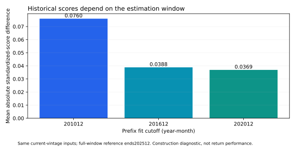

# 第二阶段：BW数据可用性、版本与构造审核

日期：2026-11-19（北京时间）。研究状态：**结构和数值审核已执行；历史实时可用性与情绪预测效力尚未建立。**

## 本轮结论

1. 作者明确将当前维护的SENT/SENT_ORTH视作低频水平指标，不建议把发布序列的简单差分解释为情绪变化。[作者README](https://github.com/BWInvestorSentimentIndex/BakerandWurglerInvestorSentimentIndex/blob/7a0165f324f06a0f88aafc253de18c63431d2a9d/README.md#L24-L30) 因此本项目保留BW作为水平状态参照的候选，不把其相邻期差分直接包装成情绪拐点。
2. 源码在完整历史区间估计标准化、正交化及PCA，当前版本另含2026年的宏观处理修订。文件的月份归属不等于当时发布时间；延后一个月不能同时修复发布、修订和拟合窗口的问题。[固定源码](https://github.com/BWInvestorSentimentIndex/BakerandWurglerInvestorSentimentIndex/blob/7a0165f324f06a0f88aafc253de18c63431d2a9d/StataCode/1.%20Create%20Baker-Wurgler%20Sentiment.do#L137-L196)
3. 五代理构造与当前发布SENT数值非常接近，但这只检验当前版本的构造一致性，不证明当时可得、预测有效或SENT_ORTH已复现。
4. 已检查作者仓库该工作簿路径的全部5个返回版本，发现真实的历史数值修订，也保留了无DATA页、数据截断的中间上传记录。Git提交时间不是首次向市场公开的时间。
5. 三条官方政策资料完成字段试点：美国公告有明确声明的发布时间，中国发布会的开始时间与完整文本可用时刻分开。预期差、反应残差及收益模型均未计算。

## 计划与实际执行

| 步骤 | 实际执行 | 证据 |
|---|---|---|
| S0 既有研究同步 | 价格数据验收、phase0/phase1结论和代码已归档；首提交89ce71ac0038e97bbf8c1f95138791501b33bca6，关键远端文件读回一致 | 总目录JOURNAL.md、PUBLICATION_ADAPTATIONS.json |
| S1 作者源码与版本 | 固定作者提交7a0165f324f06a0f88aafc253de18c63431d2a9d；核对README、3份Stata文件、备忘录和工作簿；追加检查所有早期工作簿版本 | citation_audit.json、availability_matrix.csv、revision_audit |
| S2 数值构造诊断 | 依冻结方案执行原始代理PC1与发布SENT对照、四个前缀拟合；用直接滚动计算及SVD自检 | bw_diagnostic/summary.json、self_check.json |
| S3 新闻字段试点 | 实际抓取3个当前官方页面并记录哈希；无预期时保持null | news_field_pilot/events.json、summary.json |
| S4 持续记录 | 本报告、结果、限制、下一步进入研究日志；远端同步以本轮最终提交回执为准 | 总目录steps.json、STATUS.json及Git历史 |

工作簿版本历史检查是S1的追加诊断：使用该路径返回的所有历史版本，不按差异大小选版本，不改变S2冻结方案。此前其他个人平台/新闻模型记录维持原状态，本轮没有重跑或重新认证那些实验。

## 源码说明的使用边界

| 观察到的内容 | 对研究的含义 |
|---|---|
| 原六代理版本中的NYSE换手代理已移除，当前为五代理 | 论文原始版本、当前发布数据和自行重构必须分别命名 |
| 代理存在12个月平滑/滞后 | 月差未必是即时情绪变化，不能按相邻点变化解释 |
| 标准化、正交化和PCA使用传入的整段区间 | 当前全历史分数不是每个历史时点重新拟合所得 |
| 2026年的SENT_ORTH采用宏观去趋势偏离 | README旧宏观列仍有同比措辞；复现应绑定实际代码版本 |
| 宏观从FRED导入，没有本轮历史vintage恢复 | FRED说明默认历史为今天知道的信息；ALFRED可用于指定历史可用版本。[官方说明](https://fred.stlouisfed.org/docs/api/fred/realtime_period.html) |
| USREC是按NBER周期解释生成的虚拟变量 | 不能把标记的历史月份自动当成该月已公布的状态。[FRED说明](https://fred.stlouisfed.org/series/USREC) |

备忘录的基期效应和12个月移动平均去趋势说明已查阅；本轮没有独立重算其文中相关系数，也不引用该数值作为自身结果。NBER具体历史公告原文访问403，不用检索摘要冒充已读原文。

## 当前版本数值对照

NYU与固定GitHub工作簿字节哈希不同，但两者DATA表的816行、15列数值和缺失位置一致。README标签为2026年3月，不能据此补造每个月的实际发布日期。

对五条原始代理执行12个月IPO数量合计、数量加权首日收益及规定滞后、相关矩阵PC1和样本标准化，以IPO数量载荷为正固定符号。与发布SENT有726个共同有效月，均方根差为**4.201e-08**，最大绝对差为**2.307e-07**。代码、数据、原始代理和输出哈希在运行回执中；本轮未运行Stata，不能称完整官方程序认证复现。

改变拟合截止、保持同一当前版本输入：

| 拟合截止YYYYMM | 共同历史月数 | 与全窗口相关 | 平均绝对分数差 | 最大绝对分数差 |
|---|---:|---:|---:|---:|
| 201012 | 546 | 0.99987026 | 0.075982 | 0.244087 |
| 201612 | 618 | 0.99995101 | 0.038840 | 0.110758 |
| 202012 | 666 | 0.99996009 | 0.036900 | 0.069837 |
| 202512 | 726 | 1.00000000 | 0.000000 | 0.000000 |

单位为标准化指标分数，不是收益率或百分点。差异包含标准化尺度与PCA载荷变化，不能把它解释为真实情绪修订量、虚假超额收益或预测影响。相关系数很高既不能证明历史可用性，也不能证明该构造问题产生了多大投资偏差。

## 作者公开工作簿的版本记录

| Git记录日期UTC | 提交前缀 | DATA行数 | 最后月份 | 检查状态 |
|---|---|---:|---:|---|
| 2025-08-25 | `cbf39c061ff9` | 804 | 202412 | DATA_PRESENT_CHECK_SCOPE |
| 2026-03-26 | `cc8c4df8dc82` | 816 | 202512 | DATA_PRESENT_CHECK_SCOPE |
| 2026-04-01 | `1267e3c2dac5` | 0 | — | NO_DATA_SHEET |
| 2026-04-03 | `64be6d99f0cd` | 169 | 197201 | DATA_PRESENT_TRUNCATED_RELATIVE_TO_CURRENT_YEAR_SPAN |
| 2026-04-21 | `7a0165f324f0` | 816 | 202512 | DATA_PRESENT_CHECK_SCOPE |

2026-04-01文件只有README；2026-04-03文件只含到1972-01的DATA，本轮没有把它们静默当作完整历史。当前4月21日提交说明为更正输出上传。工作簿有缺失/短缺与作者经济研究结论是否成立是不同问题。

早期文件与当前文件在同一个历史月份的数值对照：

| 旧Git记录日期 | 指标 | 成对月份 | 平均绝对版本差 | 最大绝对版本差 | 相关 |
|---|---|---:|---:|---:|---:|
| 2025-08-25 | SENT | 714 | 0.070697 | 0.207219 | 0.99634902 |
| 2025-08-25 | SENT_ORTH | 714 | 0.083847 | 1.268075 | 0.99267744 |
| 2026-03-26 | SENT | 726 | 0.069528 | 0.207219 | 0.99636513 |
| 2026-03-26 | SENT_ORTH | 725 | 0.083247 | 1.268075 | 0.99267316 |

这是版本间同月份的审核，不是相邻月份情绪变化指标。差异混合了数据修订、样本延长、处理方法和输出更正，不能归因于其中单个原因。现有版本记录集中在2025—2026年，未恢复几十年的逐月发布存档。

## 官方新闻字段试点

| 事件 | 记录的UTC时刻 | 时刻的含义 | 尚缺什么 |
|---|---|---|---|
| 2019-01-30 FOMC声明 | 19:00 | 原声明14:00 EST发布安排 | 事前预期、历史文本版本及完整事件池 |
| 2020-03-23 FOMC声明 | 12:00 | 原声明08:00 EDT发布安排 | 预期强度、同期冲击与无选择偏差样本 |
| 2024-09-24中国政策发布会 | 01:00 | 北京09:00会议开始；完整文字首发时刻为null | 各政策发言时刻、预期与文本首发证据 |

来源：[Fed2019](https://www.federalreserve.gov/newsevents/pressreleases/monetary20190130a.htm)、[Fed2020](https://www.federalreserve.gov/newsevents/pressreleases/monetary20200323a.htm)、[国新办发布会原文转载](https://www.sse.com.cn/home/component/news/c/c_20240924_10762338.shtml)。这是有官方时间依据的历史归档样本，不是本研究在当年采到的实时记录。3条说明性事件不足以验证因子；预期差、好坏标签、反应得分和金融拟合均为未计算，事件缺失字段保存null。

## 接下来如何推进

1. BW发布序列用于低频水平对照的候选；不直接求差分来判情绪拐点。若采用自行构建的扩展窗口代理，另立名称，并逐项处理原始数据修订和可用时刻。
2. 从真实当前抓取开始保留新版本，作为未来可验证的可用性记录；旧发布时刻缺失保持未知，不回填成月末。
3. 新闻路径扩大为事先确定的完整日期事件池，分别构造政策语气/已知预期差和市场反应残差；先做价格控制，再评估4/8/12周增量。当前仓库已有个股和短期语气开发记录，本轮不把它们冒充本研究的三十年大盘新闻输入。

## 审核结论

数值审核由同一执行方完成：直接计算IPO滚动权重，使用SVD与特征值分解交叉核对，并检查未来输入扰动不影响截止前重拟合结果。自检通过；这不是外部独立验证。本轮没有市场收益回归、没有策略回测，没有取得BW预测拐点有效性的证据。

证据链：源提交/工作簿哈希 → 固定PLAN和freeze_receipt → diagnose_bw.py/audit_revisions.py → 保存结果 → 本报告；新闻字段另由news_field_pilot.py及源快照哈希支持。所有旧结果保持不动。
