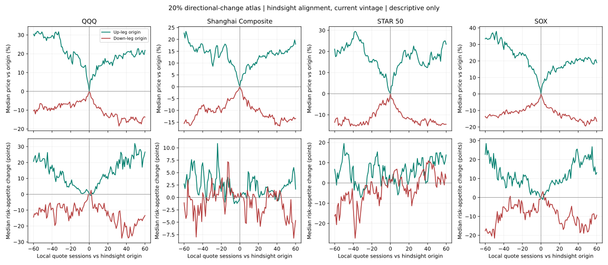

# 第三阶段研究报告：行情启动、风险情绪与反转候选

截至2026-11-19；运行 `phase3_20261119_v1_1`。结论来自冻结协议及明确登记的边界修正，已作同作者原始输入自查，没有独立复制。

## 先回答研究问题

已经完成四条可用日线历史的全样本扫描，而非只挑著名牛熊市。20%口径共 **139** 段方向已确认行情，其中 **131** 段的终点已由下一次反向阈值确认，**8** 段右删失；10%口径 **517** 段。每段都有事后起点、可观察确认日、前后候选信号、风险偏好分数、缺口与归因状态。[逐条事件卡](ALL_EVENTS_20pct_zh.md)与[全部两个阈值CSV](results_v1_1/events_all_thresholds.csv)保留所有事件。

最重要的发现是：**短窗风险价格与股票有明显同步关联，并不自动意味着能预测中期收益。** 本轮没有确立跨市场可靠的反转标准或增量预测因子。QQQ与SOX风险偏好水平对未来8周的秩相关偏负，但家族内多重比较调整后不足以作可靠预测结论；加入VIX/融资变量也未在主比较中通过该检验。

## 覆盖与“每次”的边界

|市场|开始|结束|上行腿|下行腿|完整腿|右删失腿|182日内确认|
|---|---|---|---|---|---|---|---|
|QQQ|1999-03-10|2026-11-17|15|14|28|1|29|
|上证综指|1996-01-02|2026-11-17|18|17|34|1|30|
|科创50|2020-07-23|2026-11-17|5|6|10|1|10|
|SOX|1996-01-02|2026-11-17|33|31|59|5|62|

“每次”严格指冻结方向变化算法在已验收数据内的全部输出，不能等同所有投资者主观认定的上涨和下跌。QQQ与科创50上市/发布前无数据；SOX已知7个缺失交易日期拆为5段，跨段特征与标签禁止连接。上证综指、QQQ、科创50、半导体板块代表的市场不同，尤其后两类科技暴露不能替代全市场广度。本轮没填补缺口、没制造科创50早期历史。

## 起点与确认日不能混同

|市场|上行20%确认延迟中位数/自然日|下行20%确认延迟中位数/自然日|
|---|---|---|
|QQQ|26.0|47.0|
|上证综指|68.5|75.0|
|科创50|24.0|88.0|
|SOX|21.0|48.0|

这些延迟是算法的事后描述，不是预言拐点所需的固定等待天数。20%确认可用于一致地标注历史；若以确认日才观察，行情已经走过一段，后面仍可能失败。因此没有把最低点当作当时已知的买入时机。

候选早期标准固定为：价格站上60日均线且20日收益为正；价格跌破60日均线且20日收益为负；VIX过去21个来源观测曾不低于30、且自高点回落20%；或VIX自不高于15的21观测低点抬升50%。联合条件也评估，假转真才发信号，20本地报价日冷却。阈值都是本研究预先固定的操作定义，不能称公认有效的“标准信号”。

## 如何把情绪量化

候选风险偏好分数为 `100 × (1 − VIX过去1260个来源有效观测的百分位)`，至少756个来源观测，含当期且平均处理并列。高分表示相对过去约5年美国期权风险定价较低，低分反之；它不是投资者心理的直接测量，也没有本轮验证成一个成熟因子。VIX本身衡量期权隐含近期波动预期，[FRED说明](https://fred.stlouisfed.org/series/VIXCLS)支持该定义。

另考察VIX的20观测比例变化、Baa与10年美债利差及其20观测绝对变化、10年美债收益率的20观测变化。[BAA10Y官方定义](https://fred.stlouisfed.org/series/BAA10Y)是Baa减10年美债，并非高收益债OAS；[DGS10](https://fred.stlouisfed.org/series/DGS10)是10年恒定期限美债收益率。用于中国市场时都只是外部美国风险环境，不能取代中国融资杠杆、新增开户、基金申赎、全市场涨跌广度与政策预期。

为防止同日时区与发布混淆，每个本地日期只取严格早于该日的第二近美国有效来源日期，最长陈旧7自然日。仍为当前修订版本，不能声称已恢复历史时点可得信息。[Cboe历史说明](https://www.cboe.com/tradable-products/vix/vix-historical-data/)及Andersen、Bondarenko、Gonzalez-Perez的[2024工作论文](https://cdn.cboe.com/resources/education/research_publications/VIXInterpolationWhitepaper.pdf)显示现代VIX在2003年改变方法并回算至1990，2014年又纳入周到期期权且未对旧历史作同口径回填。这是长历史可比性的额外限制，本轮未消除方法断点。

## 与股价的同步关系和预测关系

先看20观测变化窗口的重叠关联。由于美国代理滞后对齐、本地交易日历不同，它不是精确同刻的因果反应；绝不能称领先20天预测。

|市场|完整重叠窗口数|VIX变化 vs 20日本地收益 Spearman|
|---|---|---|
|QQQ|6945|-0.590|
|上证综指|7464|-0.134|
|科创50|1512|-0.216|
|SOX|7662|-0.480|

再看严格向前的8自然周结果，从下一本地收盘到期限末收盘。以下为滞后风险偏好**水平**与未来收益，不是把发布指数直接差分；CIs是126个合格日行块、999次自助法的逐项区间。16项主关联同时报告Holm调整p值。

|市场|有效日窗口数|Spearman|95%区间|Holm调整p|
|---|---|---|---|---|
|QQQ|6809|-0.138|[-0.257, -0.008]|0.640|
|上证综指|7276|-0.023|[-0.149, 0.139]|1.000|
|科创50|1453|-0.106|[-0.315, 0.195]|1.000|
|SOX|7455|-0.138|[-0.259, -0.005]|0.640|

区间未作同时覆盖调整，须结合Holm列阅读。日窗口重叠、市场相关，不能将日窗口数当成独立危机数。完整4/8/12周及分期结果见[associations.csv](results_v1_1/associations.csv)。低风险偏好水平可能出现在抛售后，使样本里的未来收益偏高；这也不是证明其可提前识别底部或构成因果机制。

## 超过单看价格，是否多提供信息

固定Ridge逐年扩展训练，测试年2011—2026，至少756条训练样本。训练标签必须在测试年开始前成熟，标准化只用训练窗。同一比较里的价格、价格+VIX、价格+融资、两者均用完全相同的合格行；另保留训练均值基线。参数未按本轮测试成绩调优，但当前历史已被研究过，不能称全新盲测。

下表为未来8周**预测均方误差相对价格模型变化**，负数较好、正数较差，不是收益率。所有测试年合并，含单列保存的2026监测期。

|市场|预测日窗口数|加VIX|加融资环境|两者都加|
|---|---|---|---|---|
|QQQ|3876|-2.16%|3.66%|-0.34%|
|上证综指|3734|2.89%|0.60%|3.05%|
|科创50|378|2.47%|1.09%|-1.87%|
|SOX|3876|1.45%|-0.04%|1.92%|

主12项市场×增加变量比较在126日块下，没有Holm调整p低于0.05的改善。科创50样本短，区间对块长度敏感，独立行情数更少，不能把单项看似改善解释成稳健有效。不同市场的拟合年数不同，见[model_fit_coverage.csv](results_v1_1/model_fit_coverage.csv)。全部变体、三期限、分期、63/126/252日块、MAE与方向准确率均保留，见[model_contrasts.csv](results_v1_1/model_contrasts.csv)和[model_summary.csv](results_v1_1/model_summary.csv)。只试一个固定模型族，本结论不排除其他结构或未来更好数据的作用。

## 早期联合信号会不会失效

下表只展示2017—2025后期检查段（科创50自有效历史开始），信号后下一收盘起算8周：同向先到±10%收盘障碍、反向先到、均未到，三类互斥。未到不是自动成功，也不是自动失败。期末平均涨跌并非策略收益。

|市场|信号|成熟信号数|同向先到|反向先到|均未到|期末平均涨跌|
|---|---|---|---|---|---|---|
|QQQ|联合转强|13|3|2|8|2.13%|
|QQQ|联合转弱|11|2|2|7|3.40%|
|上证综指|联合转强|11|2|0|9|3.10%|
|上证综指|联合转弱|11|0|1|10|2.84%|
|科创50|联合转强|6|0|3|3|-7.18%|
|科创50|联合转弱|3|0|1|2|15.32%|
|SOX|联合转强|12|7|3|2|4.94%|
|SOX|联合转弱|13|3|5|5|5.33%|

结果不足以把“恐慌回落+价格转强”当作统一反转标准。单独VIX缓解、单独价格信号、其他期限/障碍及右删失均在[alert_summary.csv](results_v1_1/alert_summary.csv)。表里的价格状态均值只是参考队列；纯风险信号自身不要求价格状态，不能把该参考队列冒称严格匹配的因果对照。增量比较应主要看前面的同样本模型诊断。

## 情绪变化轨迹

横轴为事后极值起点前后60个本地报价日。上排为价格相对起点变化，下排为风险偏好候选分数相对起点变化，中位数按市场/方向逐点计算。每点样本数及四分位数在[event_aligned_medians.csv](results_v1_1/event_aligned_medians.csv)。选择极值本身会机械地产生价格V形/倒V形；图只能帮助观察风险代理路径，不能当作预测证据。各点可用样本不同、事件可重叠，图中线不是置信区间，也不是独立样本平均投资收益。

## 政策与新闻时间线完成到了哪里

实际获取1996—2020全部25个年度档案和2021—2026当前日历，共 **26** 个官方索引，提取 **238** 条不重复声明URL。[年份覆盖](results/official_calendar/year_coverage.csv)与[全部声明链接](results/official_calendar/statement_links.csv)可逐条核对。日期来自URL，正文未在本阶段逐条读取，全文首次公开时刻、市场预期与意外程度均未建立。[Fed官方日历](https://www.federalreserve.gov/monetarypolicy/fomccalendars.htm)明确会议声明与之后发布的会议纪要不同，不能把纪要内容回填到会议当天。

每次事件卡已连接起点前后20自然日的声明URL，只有日期邻近意义。90年代并非每次不变息会议都发声明，档案也不覆盖所有非例会政策；索引条数不能解释为政策动作次数。中国30年完整政策/新闻与融资情绪资料仍未完成，不能声称已解释了每轮涨跌原因。未核实的当日新闻例子不进入原因库。

## 自查、修正与可复现性

首轮边界自查发现6处跨SOX片段注释、8个前态未知的起始信号；修正先登记[AMENDMENT_v1_1.json](AMENDMENT_v1_1.json)，原结果和原代码保留。新版本只允许已观察的假→真状态且注释不跨段，重跑后价格模型和关联表与首轮一致。

已从原SQLite逐行核对价格、特征、未来收益，核对美国代理来源日期、阈值首次达到与极值、信号冷却、先触障碍，并以增广最小二乘重拟合全部保存Ridge参数；执行未来价格扰动/对齐前缀检查。详见[self_check.json](results_v1_1/self_check.json)。这是同作者自查，不是独立验证。

每个展示数字映射至[display_cells.json](results_v1_1/display_cells.json)、原结果CSV、[run_manifest.json](results_v1_1/run_manifest.json)、代码/冻结配置及输入SHA256。公开代码和事件/汇总表；逐日商业行情、原始风险数据、模型逐行预测及参数证据保持私有，不因代码公开而获得再分发权。

## 后续研究的具体目标

1. 补齐中国本土情绪变量的原始发布版本/制度变动：融资余额与杠杆、开户和基金流量、全市场历史成分广度；长度不足就做短样本模块，不能硬拼30年。
2. 扩充有首次发布时间、市场预期、新闻新颖度的真实事件面板，区分利好兑现与利空钝化；当前价格与风险状态作为强基线，避免把涨价重新包装为情绪。
3. 原始发布版本与独立复核具备后，另行冻结新窗口/新模型；先证明相对于价格基线有跨时期稳定增量，再讨论组合权重与交易实现。

研究结论状态：**PARTIALLY_SUPPORTED**。事件库及限定输入诊断已执行；跨市场可靠反转标准、完整情绪测量、新闻因果与可交易超额收益均未确立。
