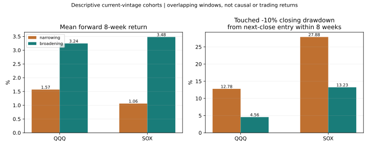

# 第四阶段：上涨参与结构与实际利率的实证诊断

本轮从图片学习推进到实际数据与模型。运行`phase4_20261119_v1`；先提交冻结合同，再计算；结果通过同作者来源重算与模型重拟合检查，没有独立复制。

## 本轮得到什么

1. 真实取得FRED分发的Nasdaq100等权指数NDXE、Nasdaq100指数NDX，以及10年期TIPS收益率DFII10。不是纳斯达克综合指数，也未用今天的成分重建过去。原始来源及哈希见[input_manifest.json](input_manifest.json)。
2. 在观察性状态对比中，QQQ和SOX在“NDX上涨但等权相对落后”时，之后8周平均收益较低；但四项比较作Holm调整后未达到0.05，不能据此确认可预测底顶。
3. 在原有价格+VIX+信用/利率强基线之外加入参与结构、TIPS和交互项，没有确立稳健的预测改善。美国两个主要观察对象的主比较中，所有新增模块的预测误差点估计都变差。

这支持继续追踪“结构变化”作为背景状态，不支持现在就把它设为交易开关；也不能由一个模型族的负面结果断言市场广度毫无用处。

## 定义和覆盖

`breadth60 = NDXE过去60个配对来源观测收益 − NDX同期收益`；20观测差也保留。NDX60观测收益大于零、相对收益差小于零记为narrowing，非负记为broadening；NDX60观测收益不大于零记weak。

该代理衡量等权与修改市值加权表现的差异，可受规模、行业、个股相对表现和再平衡影响；**不直接测量上涨家数，也不直接测量权重集中度或心理情绪**。等权弱于市值指数，不必然意味着多数股票下跌。当前官方方法说明两指数证券集合相同、采用等权发行人处理并按季再平衡；当前方法不能未经审核回填成所有历史时期都一致的方法。见[Nasdaq方法](https://indexes.nasdaqomx.com/docs/methodology_NDXE.pdf)。

DFII10为10年TIPS恒定期限收益率，作为实际利率环境代理；不是股票完整贴现率或政策利率。名义与实际利率不同，不能把剩余项机械解释为纯通胀预期或纯风险溢价。

|市场|新变量完整特征开始|结束|完整特征行数|
|---|---|---|---|
|QQQ|2005-09-26|2026-11-17|5200|
|SOX|2005-09-26|2026-11-17|4948|
|上证综指（美国外部指标）|2005-09-26|2026-11-17|5018|
|科创50（美国外部指标）|2021-08-03|2026-11-17|1281|

NDXE来源覆盖始于2005-06-28，DFII10始于2003-01-02；本轮共同特征覆盖更短，不能称30年广度研究。配对源有两个单边不一致日期：2008-11-14, 2019-04-19。保守分成3段，20/60观测特征重新预热；不对缺口补价，部分危机窗口因此没有合格特征。缺失日期不在本轮认定为交易所休市或供应商错误，只标为两源不一致。

所有新美国变量取严格早于本地日的第二近有效来源观测，最多陈旧7自然日；未来收益沿用前阶段下一收盘起算4/8/12自然周及跨段/跨期排除。当前版本滞后不是历史PIT认证。上证和科创所用变量只是美国外部结构/利率环境，不能称为A股本土广度。

Nasdaq官方当前方法的附录列出2026-05-01再平衡参考日期及替换规则调整。2026保留监测期身份，按期单列；本轮没有逐版重建历史规则，不能把全历史理解成同口径新盲测。

## 状态关联：缩窄之后是否更弱

全部可用日窗口的8周观察性对比，不要求这些日子最终形成20%顶部；未选取事后成功案例。

|市场|缩窄窗口n|扩散窗口n|缩窄后平均收益|扩散后平均收益|均值差：缩窄−扩散|Holm调整p|
|---|---|---|---|---|---|---|
|QQQ|2425|1227|1.57%|3.24%|-1.67个百分点|0.168|
|SOX|2346|1073|1.06%|3.48%|-2.42个百分点|0.168|
|上证综指（美国外部指标）|2376|1149|-0.05%|3.83%|-3.88个百分点|0.168|
|科创50（美国外部指标）|707|118|0.26%|-2.85%|3.12个百分点|0.912|

每项95%区间来自126个合格日行的移动块自助法999次，见[state_contrasts.csv](results/state_contrasts.csv)。这些是重叠日窗口，n不是独立危机次数。逐项区间没有同时覆盖保证，不能跳过多重比较列只挑区间不含零的市场。

图右为从下一收盘起算、未来8周某次收盘至少跌10%的窗口比例，是路径事件频率，不是止损策略亏损率。源表[state_summary.csv](results/state_summary.csv)还保留weak状态、期末负收益比例、4/12周及各时期。该图为点估计，**不是经风险控制后的概率预测**。两个队列的时间、波动率、宏观环境不同，不能将差异归因为参与结构本身。科创50的状态均值差方向与其他市场不同，短样本不能支持跨市场推广。

## 增量检验：强基线之外是否有用

基线含本地20/60日收益、均线差、252日回撤、20日波动、VIX水平代理与变化、Baa利差水平与变化、名义10年利率变化。新增模块分别为20/60观测参与差、TIPS水平/20观测变化、以及两者加预指定交互项。

逐年扩展训练2011—2026，至少756条；训练标签须在测试年初前成熟，标准化仅拟合训练。四个模型共享完整行，不用不同样本比较。alpha1为主，alpha10敏感性。全部使用固定Ridge，因此只检验该模型族；没有寻找最佳模型或最佳阈值。

下表是未来8周预测**均方误差相对强基线的变化**：正数较差、负数较好；它不是投资收益。测试年合并含单列保存的2026监测期。

|市场|预测日窗口n|增加参与结构|增加实际利率|增加两者和交互|
|---|---|---|---|---|
|QQQ|3816|8.10%|9.59%|18.28%|
|SOX|3816|2.57%|10.20%|11.44%|
|上证综指（美国外部指标）|3676|-3.50%|7.85%|7.28%|
|科创50（美国外部指标）|378|0.27%|3.58%|7.34%|

主12项比较没有经Holm调整后通过的改善；美国QQQ/SOX主三模块点估计均变差。不能将这些点估计夸大成统计上证明普遍有害。全部均方误差差值区间、p值、63/126/252日块、三期限、两alpha和各时期见[model_contrasts.csv](results/model_contrasts.csv)，绝对误差/方向准确率见[model_summary.csv](results/model_summary.csv)。alpha10没有作为新的主假设重新挑选，也未将未经调整的敏感性p值当成确认结果。

共保存1200个确定性拟合、70082行逐日预测（含两个alpha）；行数和拟合数不是独立市场数或独立复制次数。科创50主8周模型仅378个测试日窗口，独立时期少，不能作强结论。

## 仍缺什么，下一步怎样做

|模块|本轮实际状态|含义|
|---|---|---|
|美国等权/市值参与结构|已取得并检验|是结构代理，不能替代全市场涨跌广度|
|实际利率环境|已取得并检验|价格+风险强基线之外未建立可靠改善|
|A股本土历史广度|未取得合格矩阵|官方年度概况入口不等于逐日历史成分数据；不能回填今日成分|
|新闻反应不对称|BLOCKED，未运行金融效力检验|还缺去重新闻、首次发布时间、市场预期与成熟反应窗口|
|历史盈利预期修订|未取得|不能用事后盈利替代当时预测|
|Put/Call长历史延续|仅核验页面覆盖|Cboe列出的近期历史文件止于2019；未拼接为完整当前序列，不意味着更近数据不存在|

下一阶段优先补真正能识别信息变化的输入：可追溯首次发布时间的政策/财报事件与当时预期，以及当时成分广度。对“利好推动力减弱”的检验，必须控制消息意外程度和原有价格趋势。先形成真实事件面板，再固定新实验，不能仅把现有价格做更多变换并改名为情绪。

## 审核与追溯

已核对23749行前阶段输入保持不变、47498个来源日期、118745个新特征单元、68993个收盘路径最小值。用增广最小二乘重拟合全部1200个模型，核对全部汇总与对照、前缀不变性。详见[self_check.json](results/self_check.json)。这是同作者自查，不是独立复制。

数字链为[display_cells.json](results/display_cells.json)→结果CSV→[run_manifest.json](results/run_manifest.json)内逐行私有结果哈希→冻结配置和输入身份；来源核验见[citation_audit.json](citation_audit.json)。原始Nasdaq数据、TIPS输入和逐行面板/预测私有保存，公开汇总不授予原始数据再分发权。

最终状态：PARTIALLY_SUPPORTED。计划执行、数值追溯、指定引用审核通过；实验充分性LIMITED。没有确立可交易反转标准、完整情绪因子或新闻因果。
